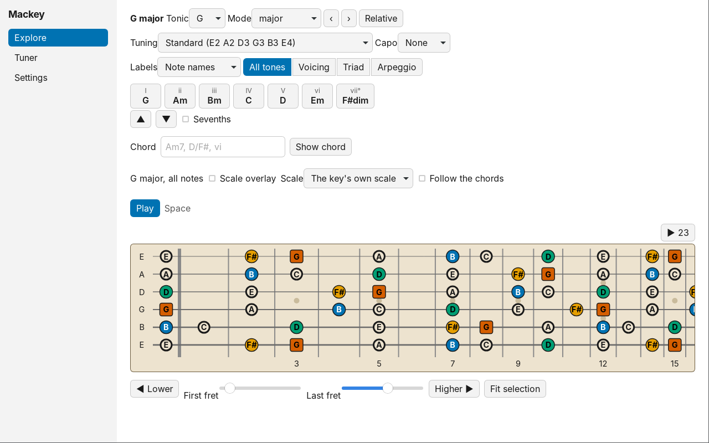
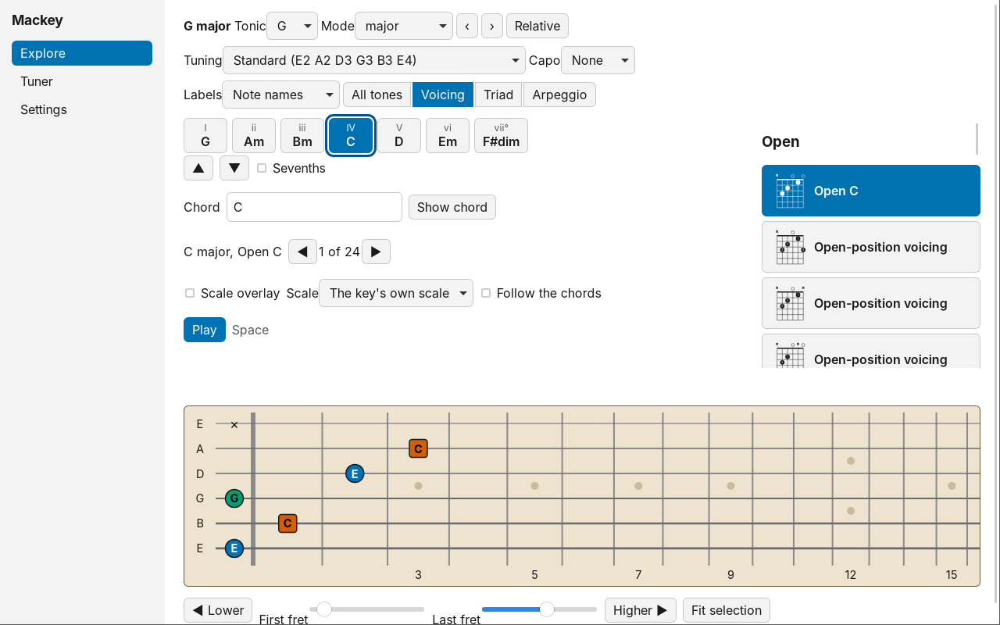
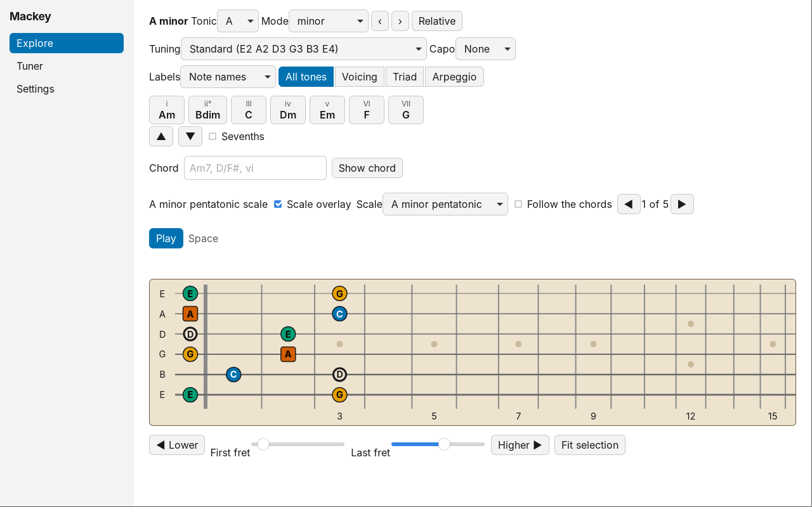
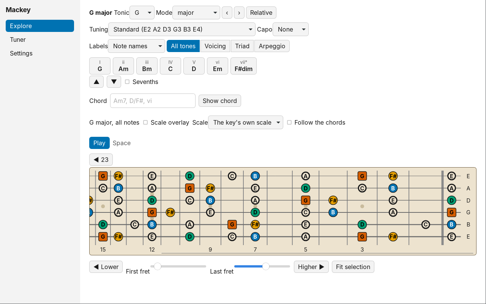
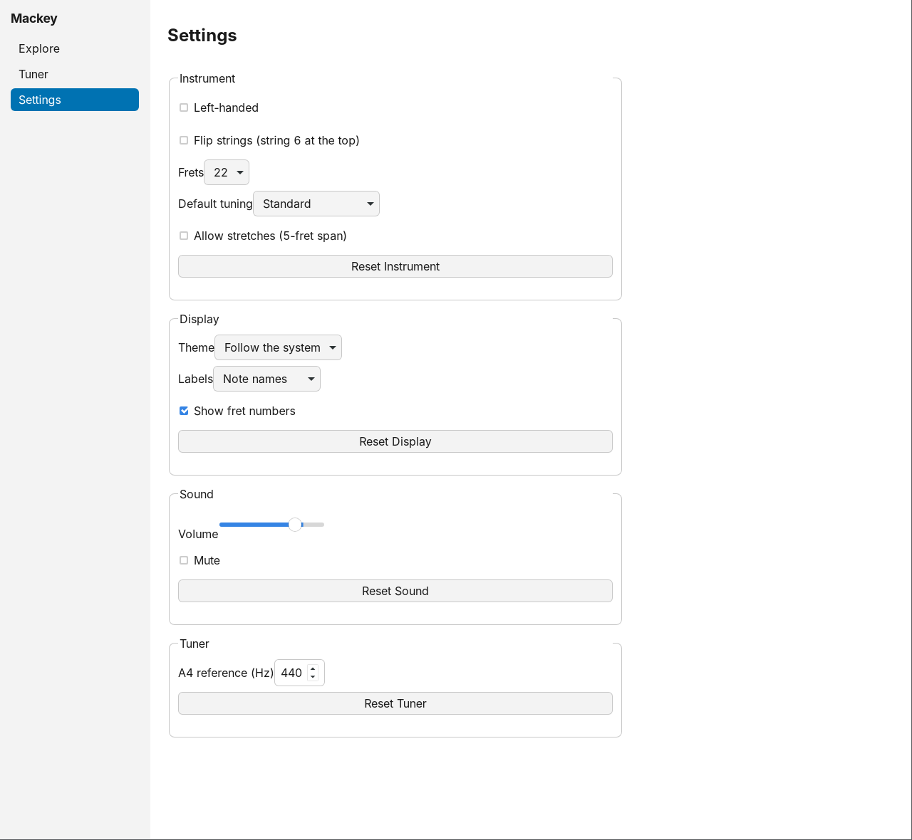
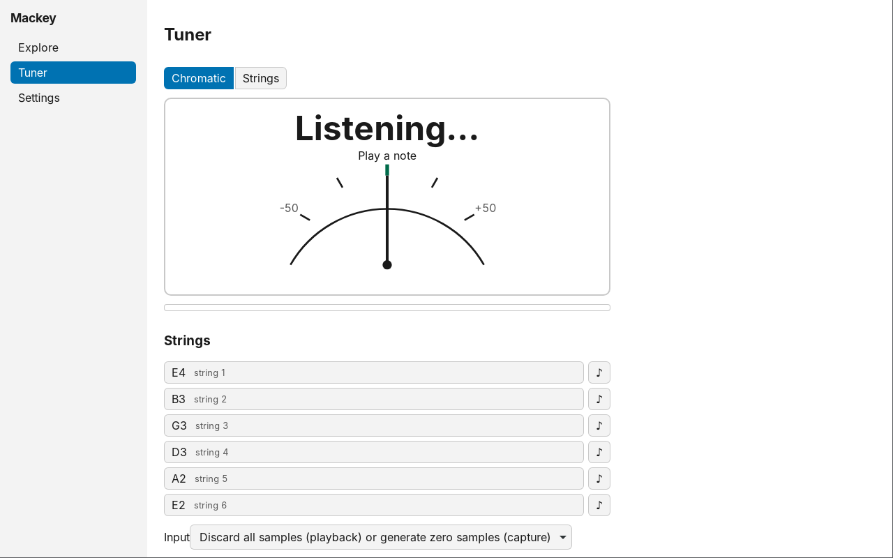

# Mackey Guitar Tutor

An app for macOS and iPad that helps beginner and intermediate guitarists learn the fretboard and play real songs. A Rust core (Cargo workspace) sits behind a Tauri 2 shell and a React + TypeScript UI whose fretboard is drawn in SVG.

## What works now

The first feature, the **fretboard foundation** ([spec](specs/archive/261115-fretboard-foundation/spec.md)), is built: three screens, backed by the Rust core.

- **Explore.** Pick a key and mode; see every note on a 19 to 24 fret neck; pick a chord from the key or type any chord symbol; see voicings (open, barre and position shapes), triads on every string set and inversion, arpeggios by position, and scale overlays including the five pentatonic boxes. Cycle everything from the keyboard. Nine tunings, custom tunings, capo, left-handed and flipped views. Notes carry a shape as well as a colour (root square, chord tone circle, scale tone ring).
- **Tuner.** Chromatic and per-string modes with reference tones; pitch detection runs on the device.
- **Settings.** Instrument, display, sound and tuner options, saved as JSON.

Not built yet: practice sessions, songs, rhythm, sound from a SoundFont, the iPad audio-session plugin, signed releases and testing on a real iPad. See the [roadmap](docs/roadmap.md).













These are screenshots of the real app (Rust core, WebKit webview) running under a virtual display on Linux; see [docs/images](docs/images/README.md) for how each was made and what is mocked. The tuner shot has no microphone, so it shows the real "Listening…" state.

## Use it

Build and install from source on a Mac, then read the guides in [user-docs/](user-docs/README.md):

| Guide | Covers |
|---|---|
| [Getting started](user-docs/getting-started.md) | Build, install, first launch, a five-minute tour |
| [Explore](user-docs/explorer.md) | Keys, chords, voicings, triads, arpeggios, scales, shortcuts, left-handed, tunings, capo |
| [Tuner](user-docs/tuner.md) | Microphone, modes, reference tones |
| [Settings](user-docs/settings.md) | Every setting and its default |
| [Troubleshooting](user-docs/troubleshooting.md) | Gatekeeper, microphone permission, no sound |

## Design

Product spec, architecture and roadmap live in [docs/](docs/README.md). Start with [INTENT.md](INTENT.md) for purpose and scope, then the PRD in [docs/prd/](docs/prd/README.md) and [docs/architecture.md](docs/architecture.md).

| Crate or folder | Role |
|---|---|
| [crates/mackey-theory](crates/mackey-theory/README.md) | Notes, intervals, scales, keys, chords, chord-symbol parser, Roman numerals, analysis, spelling (pure) |
| [crates/mackey-voicing](crates/mackey-voicing/README.md) | Tunings and capo, voicing search, fingering, triads, arpeggios, scale patterns, selection model, `FretboardView`, playback plan (pure) |
| [crates/mackey-audio](crates/mackey-audio/README.md) | cpal streams, Karplus-Strong synth, MPM pitch detector, tuner state machine; the only crate that opens audio devices |
| [src-tauri](src-tauri/README.md) | `mackey-app`: Tauri commands, tuner event, settings, app state (a thin adapter) |
| [ui](ui/README.md) | React + TypeScript + Vite: the shared SVG fretboard, Explore, Tuner, Settings |
| [xtask](xtask/README.md), [scripts](scripts/README.md) | Repo checks; real-app screenshots |

The UI draws what Rust sends it. The core computes everything a test should check (which frets light up, which voicing is chosen); the TypeScript types are generated from the Rust types with `ts-rs`.

## Quick start (developers)

You need the pinned Rust toolchain (rustup installs it from `rust-toolchain.toml`), Node 22 and, on Linux, the WebKitGTK and ALSA dev packages listed in [.github/README.md](.github/README.md).

```sh
make tools                       # once: cargo-deny and cargo-llvm-cov
npm ci --prefix ui               # UI dependencies
make check                       # fmt, clippy, layer and docs checks, licences, Rust and UI tests, bindings
npx --prefix ui playwright install --with-deps webkit   # once, for make e2e
make e2e                         # Playwright against the mocked command layer
npm run tauri dev                # the app with hot reload (repo root)
```

`make build` and `make test` work without building the UI.

### Every make target

| Command | Purpose |
|---|---|
| `make build`, `make test` | Build and test the workspace (unit, integration, doc tests) |
| `make props` | Property tests at 10 000 cases, release mode |
| `make lint`, `make fmt`, `make fmt-check` | clippy at `-D warnings`; rustfmt |
| `make cover` | Line coverage (target 80% or more) |
| `make archcheck`, `make doccheck` | Crate layer rules; every `.PHONY` target and folder is documented |
| `make deny` | Licences, advisories, bans, sources |
| `make tools` | One-time install of `cargo-deny` and `cargo-llvm-cov` |
| `make check` | fmt, lint, archcheck, doccheck, deny, test, ui-lint, ui-test, bindings-check: run before every commit |
| `make ui-lint`, `make ui-test` | ESLint, Prettier, `tsc`; Vitest |
| `make e2e` | Playwright (WebKit; desktop, iPad, iPad portrait, narrow) against the mocked command layer |
| `make bindings`, `make bindings-check` | Regenerate the TypeScript types from Rust; fail when they are stale |
| `make app` | Universal (arm64 and x86_64) ad-hoc signed `.app` and `.dmg` on macOS; a host binary elsewhere |
| `make ios-sim` | Unsigned debug build for the iOS Simulator (`tauri ios build --debug --target aarch64-sim --ci`; macOS with Xcode) |
| `make screenshots` | Linux only, optional: real-app screenshots under Xvfb into `docs/images/` |

Rules for people and AI agents are in [AGENTS.md](AGENTS.md): crate layer rules, TDD with proptest and insta, Rust error handling, documentation and the dev-flow spec workflow (`specs/`). Folder guides: [src-tauri/](src-tauri/README.md), [ui/](ui/README.md), [crates/](crates/README.md), [xtask/](xtask/README.md), [scripts/](scripts/README.md), [specs/](specs/README.md), [user-docs/](user-docs/README.md), [.github/](.github/README.md), [.claude/](.claude/README.md).
