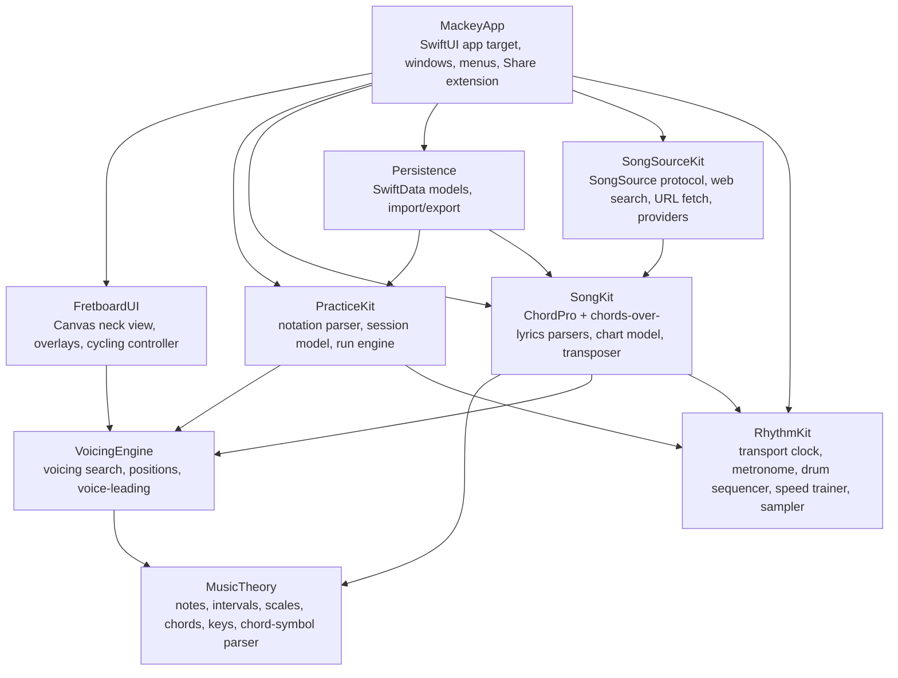
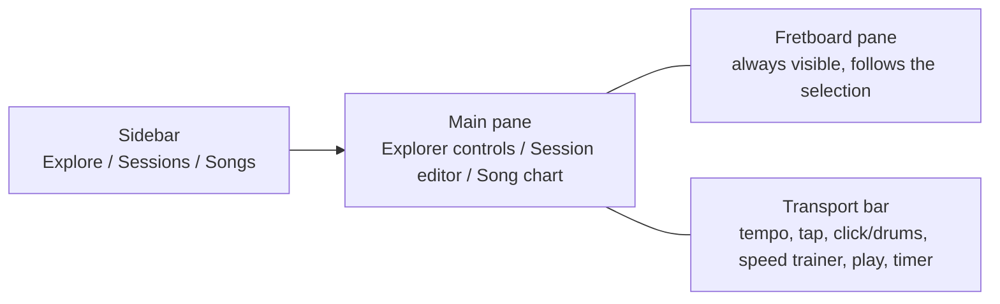

# Architecture

Status: Draft v0.1 (2026-11-15)

## 1. Technology choices

| Concern | Choice | Why | ADR |
|---------|--------|-----|-----|
| Language / UI | Swift 6, SwiftUI, macOS 15+ | Native macOS app per README; path to iPad later | [0001](adr/0001-native-swiftui-macos.md) |
| Fretboard rendering | SwiftUI `Canvas` | Fast immediate-mode drawing, easy hit-testing | 0001 |
| Modularity | Local Swift packages, one per domain | Pure, testable core with no UI or I/O | [0002](adr/0002-pure-music-theory-core.md) |
| Persistence | SwiftData, plus plain-text source of truth for sessions and songs | Sessions are notation text, songs are ChordPro, so data is portable | [0003](adr/0003-text-first-persistence.md) |
| Audio and rhythm | AVAudioEngine + `AVAudioUnitSampler` (guitar and General MIDI drum SoundFonts); one sample-accurate transport clock for metronome, drums and visuals | No dependencies, low latency, clean sound at any tempo | [0005](adr/0005-sequenced-drums.md) |
| Song content | Local-only, user-initiated import; no scraping service | Legal and App Review risk | [0004](adr/0004-user-initiated-song-import.md) |
| Testing | Swift Testing for packages, XCUITest for smoke flows | | |

## 2. Module layout



Rules:

- `MusicTheory` and `VoicingEngine` are pure Swift: no SwiftUI, no Foundation I/O, deterministic, value types. They are the most heavily tested code.
- `PracticeKit` and `SongKit` depend on the theory layer only, never on UI. Their parsers are pure functions from `String` to a result with diagnostics.
- Only `SongSourceKit` touches the network.
- `RhythmKit` owns the audio engine and the `TransportClock`. Features subscribe to clock positions; nothing else keeps its own timer. Design in [rhythm.md](rhythm.md).

## 3. Domain model

### 3.1 Music theory (value types)

```swift
struct PitchClass { let semitone: Int }            // 0...11, C = 0
struct Note { let letter: Letter; let accidental: Int }  // spelled: F# != Gb
struct Pitch { let note: Note; let octave: Int }   // MIDI-convertible
struct Interval { let quality: Quality; let number: Int }  // M3, P5, b7
struct Scale { let tonic: Note; let mode: Mode }   // degrees() -> [Note]
struct Key { let scale: Scale }                    // diatonicChord(.iv, seventh: false)
struct ChordQuality { let intervals: [Interval]; let symbol: String }  // "m7b5"
struct Chord { let root: Note; let quality: ChordQuality; let bass: Note? }  // D/F#
enum ChordSymbolParser { static func parse(_ s: String) -> Result<Chord, ParseError> }
enum RomanNumeral { static func chord(_ s: String, in key: Key) -> Chord? }  // "vi" in G -> Em
```

Spelling matters: a beginner in F should see Bb, not A#. Keys own the spelling rules and every displayed note is spelled from its key.

### 3.2 Fretboard and voicings

```swift
struct Tuning { let strings: [Pitch] }             // low to high; .standard = E A D G B E
struct Instrument { let tuning: Tuning; let frets: Int; let capo: Int }
struct FretPosition { let string: Int; let fret: Int }
struct Voicing {
    let chord: Chord
    let frets: [Int?]          // per string, nil = muted
    let fingers: [Int?]        // 1...4, 0 = open, T = thumb (later)
    let kind: Kind             // .open, .caged(.e), .triad(strings: 1...3, inversion: 1), .arpeggio(position: 5)
    var span: Int { get }      // fret stretch, used for playability
}
enum Position { case fretWindow(ClosedRange<Int>) case caged(CAGEDShape) }
```

### 3.3 Practice sessions

```swift
struct PracticeSession {
    var id: UUID; var name: String
    var source: String                 // the quick-entry text, always the source of truth
    var key: Key?
    var items: [PracticeItem]          // derived by parsing `source`
    var transitions: [Transition]      // items[i] -> items[i+1], with focus flag
    var method: PracticeMethod
    var tempo: Tempo?                  // bpm + time signature
    var backing: BackingSettings?      // click or drum pattern, see rhythm.md
}
enum PracticeItemKind { case chord, triad(inversion: Int?, strings: StringSet?), arpeggio(direction: Direction, position: Int?), note }
struct PracticeItem { let kind: PracticeItemKind; let target: Chord /* or Note */; let duration: Duration; let voicingHint: VoicingHint? }
struct Transition { let from: Int; let to: Int; let isFocus: Bool }
enum PracticeMethod { case oneMinuteChanges(seconds: Int), speedTrainer(SpeedTrainer), loop(times: Int?), random, nameTheNote, strum(pattern: String) }
struct PracticeRun { let sessionID: UUID; let date: Date; let tempoReached: Int?; let changesPerMinute: [TransitionKey: Int]; let rating: Int? }
```

### 3.4 Songs

```swift
struct Song {
    var id: UUID; var title: String; var artist: String?
    var key: Key?; var capo: Int; var tempo: Int?; var meter: Meter?
    var lastCleanTempo: Int?           // from the speed trainer
    var sections: [Section]            // verse, chorus, bridge, or unnamed
    var provenance: Provenance         // .pasted, .file(URL), .web(url, fetchedAt), .provider(name, id)
    var chordPro: String               // canonical serialised form
}
struct Section { let label: String?; let lines: [Line] }
struct Line { let lyrics: String; let chords: [ChordAnchor] }    // chord at character offset
struct ChordAnchor { let offset: Int; let symbol: String; let chord: Chord? }  // chord nil = unparsed, user can fix
```

### 3.5 Persistence

SwiftData entities wrap the text sources: `SessionRecord(id, name, source, createdAt, updatedAt)`, `RunRecord(sessionID, date, startTempo, endTempo, cleanTempo, changesPerMinute, rating)`, `SongRecord(id, title, artist, chordPro, provenance, voicingOverrides)`. Parsed models are rebuilt on load. Upgrading the parser upgrades every stored session without a migration. Export is a folder of `.mackey` (notation) and `.cho` files.

## 4. Key algorithms

### 4.1 Voicing search (VoicingEngine)

Inputs: chord, instrument, constraints (string set, fret window, max span, allow open strings, inversion). Approach:

1. For each string, list frets within the window whose pitch class is a chord tone (or mute).
2. Depth-first search across strings with pruning: span ≤ 4 (configurable), at most 4 fretted notes (barre counts as one finger), required tones present (root and third; fifth optional), bass note matches inversion or slash bass.
3. Score each result: span, number of fingers, open strings bonus for beginners, root-in-bass bonus, string-skip penalty. Return the top N, sorted.
4. Curated shape library (open chords, CAGED barre shapes, triads) is checked first, so the common shapes are always exactly what a teacher would draw. Search fills the gaps.

Fingering: assign fingers by fret order within the window, with barre detection when the lowest fret repeats across strings.

### 4.2 Voice-leading path (songs and practice)

Given a chord sequence, choose one voicing per chord to minimise total movement. Model as a shortest path through a layered graph (layer = chord, node = candidate voicing). Edge cost = hand shift (difference in window start) + fingers that move + changes of string set, with a bonus for common tones held in place. Solved with dynamic programming (Viterbi), O(n x k²) with k ≈ 10 candidates per chord, which is instant. The user can pin a voicing; pinned layers have a single node.

### 4.3 Chords-over-lyrics detection (SongKit)

Classify each line as `chord`, `lyric`, `section header`, `tab`, or `blank`. A line is a chord line when at least about 80% of its whitespace-separated tokens parse as chord symbols (also allowing `|`, `x2`, `N.C.`, `/`). Chord lines are merged with the following lyric line by column offset. Full detail in [song-import.md](song-import.md).

### 4.4 Key detection

Score each of the 24 major/minor keys by how many song chords are diatonic, weighted by duration and by first/last chord. Show the top candidate with a confidence and let the user override.

## 5. UI composition



The fretboard is one shared view model (`FretboardState`: instrument, key, highlighted positions, ghost positions, labels mode). Every feature drives it through the same API, so it behaves identically in explorer, practice and song views.

## 6. Quality and engineering practice

- Theory and parser code test-first, with table-driven tests (e.g. every chord quality in every key, spelled correctly).
- A `Fixtures/` corpus of chord sheets (written for the project or public domain) is the regression suite for the song parser.
- CI on GitHub Actions: `swift build`, `swift test` per package, SwiftLint, then an app build on `macos-latest`.
- A `CLAUDE.md` at the repo root with build/test commands and module rules, so agentic contributors respect the layer boundaries.
