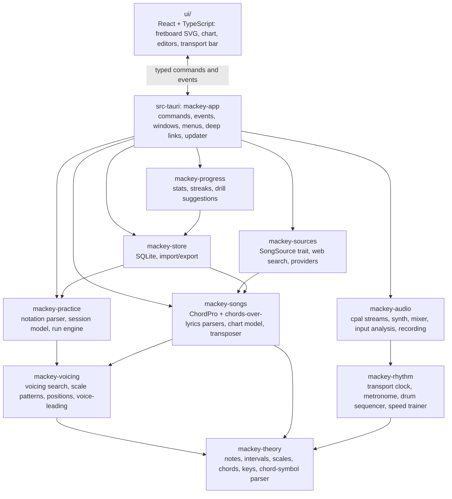
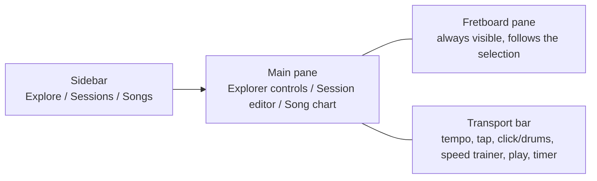
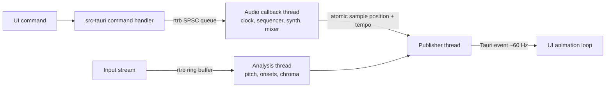

# Architecture

Status: Draft v0.2 (2026-11-15). Stack: Rust core, Tauri 2 desktop shell, web UI. Target: macOS only for now (universal build). Windows, Linux and mobile are deferred; the design keeps them possible but we do not build or test for them yet.

## 1. Technology choices

| Concern | Choice | Why | ADR |
|---------|--------|-----|-----|
| Core language | Rust (stable, 2024 edition) in a Cargo workspace | Strong types for music theory, safe and predictable real-time audio, portable if other platforms are added later | [0001](adr/0001-rust-core-tauri-shell.md) |
| App shell | Tauri 2 | Small native Mac app with the Rust backend in-process; other platforms possible later | 0001 |
| UI | TypeScript, React, Vite; fretboard drawn in SVG | Mainstream skills, crisp scalable neck, built-in hit-testing and accessibility | [0007](adr/0007-web-ui-and-ipc-boundary.md) |
| UI to core boundary | Tauri commands and events with generated TypeScript types (tauri-specta or ts-rs) | One source of truth for types, compile-time checked on both sides | 0007 |
| Modularity | One crate per domain; pure core crates with no I/O | Testable, reusable on mobile and in a CLI | [0002](adr/0002-pure-music-theory-core.md) |
| Persistence | SQLite (rusqlite, bundled) in `~/Library/Application Support/`; plain text is the source of truth for sessions and songs | Portable data, zero setup | [0003](adr/0003-text-first-persistence.md) |
| Audio output and rhythm | cpal on CoreAudio + rustysynth SoundFont synth for guitar and GM drums; one sample-accurate transport clock | Native low latency without a web audio dependency; clean sound at any tempo | [0005](adr/0005-sequenced-drums.md) |
| Audio input | cpal input stream; McLeod/YIN pitch, onsets, chroma verification; ONNX Runtime (ort) model later | Offline, private, no backend | [0006](adr/0006-on-device-audio-analysis.md) |
| Song content | Local-only, user-initiated import; no scraping service | Legal and store-review risk | [0004](adr/0004-user-initiated-song-import.md) |
| Distribution | Notarized, signed universal `.dmg` with the Tauri updater; Mac App Store optional later | No dependency on store review for v1 | |
| Testing | `cargo test` with proptest (properties) and insta (golden files), criterion benchmarks; Vitest for UI logic; Playwright against the dev UI and tauri-driver for end-to-end smoke tests | | |

## 2. Module layout



Rules:

- `mackey-theory`, `mackey-voicing`, `mackey-practice` and `mackey-songs` are pure: no I/O, no threads, no global state, deterministic. Parsers are pure functions from `&str` to a result with diagnostics. They contain nothing macOS-specific, so they would compile unchanged for other targets later.
- `mackey-rhythm` is pure scheduling logic (what happens at which sample). `mackey-audio` is the only crate that opens audio devices, and the only one that reads the microphone ([ADR 0006](adr/0006-on-device-audio-analysis.md)).
- Only `mackey-sources` touches the network.
- `src-tauri` is a thin adapter: it maps commands to core calls, owns app state behind a mutex (never touched by the audio thread), and forwards events. No music logic lives there.
- The UI holds view state only. Anything a test should check (which frets to light, which voicing is chosen) is computed in Rust and sent to the UI as data.

## 3. Domain model

All core types are plain Rust values deriving `Clone, Debug, PartialEq, Eq, Hash, serde::Serialize/Deserialize` where meaningful, with TypeScript types generated for those that cross into the UI.

### 3.1 Music theory

```rust
pub struct PitchClass(u8);                                    // 0..=11, C = 0
pub struct Note { pub letter: Letter, pub accidental: i8 }    // spelled: F# != Gb
pub struct Pitch { pub note: Note, pub octave: i8 }           // MIDI-convertible
pub struct Interval { pub quality: IntervalQuality, pub number: u8 }  // M3, P5, m7
pub struct Scale { pub tonic: Note, pub mode: Mode }          // degrees() -> Vec<Note>
pub enum Mode { Major, NaturalMinor, HarmonicMinor, Dorian, Phrygian, Lydian, Mixolydian, Locrian,
                MajorPentatonic, MinorPentatonic, Blues }
pub struct Key { pub scale: Scale }                           // diatonic_chord(Degree::IV, Seventh::No)
pub struct ChordQuality { pub intervals: Vec<Interval>, pub symbol: &'static str }  // "m7b5"
pub struct Chord { pub root: Note, pub quality: ChordQuality, pub bass: Option<Note> }  // D/F#
pub fn parse_chord_symbol(s: &str) -> Result<Chord, ChordParseError>;
pub fn roman_to_chord(s: &str, key: &Key) -> Option<Chord>;   // "vi" in G -> Em
```

Spelling matters: a beginner in F should see Bb, not A#. Keys own the spelling rules and every displayed note is spelled from its key.

### 3.2 Fretboard and voicings

```rust
pub struct Tuning { pub name: String, pub strings: Vec<Pitch> }   // low to high; presets: standard, drop_d, dadgad, open_g, ...
pub struct Instrument { pub tuning: Tuning, pub frets: u8, pub capo: u8 }
pub struct Handedness { pub mirrored: bool, pub low_string_on_top: bool }
pub struct FretPosition { pub string: u8, pub fret: u8 }
pub struct Voicing {
    pub chord: Chord,
    pub frets: Vec<Option<u8>>,      // per string, None = muted
    pub fingers: Vec<Option<u8>>,    // 1..=4, 0 = open
    pub kind: VoicingKind,           // Open, Caged(Shape), Triad { strings, inversion }, Arpeggio { position }
}
pub struct ScalePattern { pub scale: Scale, pub kind: PatternKind, pub positions: Vec<FretPosition> }  // pentatonic box 1..5, 3nps
pub enum Position { FretWindow(RangeInclusive<u8>), Caged(CagedShape) }
```

### 3.3 Practice sessions

```rust
pub struct PracticeSession {
    pub id: Uuid, pub name: String,
    pub source: String,                  // the quick-entry text, always the source of truth
    pub key: Option<Key>,
    pub items: Vec<PracticeItem>,        // derived by parsing `source`
    pub transitions: Vec<Transition>,    // items[i] -> items[i+1], with focus flag
    pub method: PracticeMethod,
    pub tempo: Option<Tempo>,            // bpm + meter
    pub backing: Option<BackingSettings>,// click or drum pattern, see rhythm.md
}
pub enum PracticeItemKind { Chord, Triad { inversion: Option<u8>, strings: Option<StringSet> },
                            Arpeggio { direction: Direction, position: Option<u8> }, Note }
pub struct PracticeItem { pub kind: PracticeItemKind, pub target: Target, pub duration: Duration, pub hint: Option<VoicingHint> }
pub struct Transition { pub from: usize, pub to: usize, pub is_focus: bool }
pub enum PracticeMethod { OneMinuteChanges { seconds: u16 }, SpeedTrainer(SpeedTrainer), Loop { times: Option<u16> },
                          Random, NameTheNote, Strum { pattern: String } }
pub struct PracticeRun { pub session_id: Uuid, pub date: DateTime<Utc>, pub tempo_reached: Option<u16>,
                         pub changes_per_minute: HashMap<TransitionKey, u16>, pub rating: Option<u8> }
```

### 3.4 Songs

```rust
pub struct Song {
    pub id: Uuid, pub title: String, pub artist: Option<String>,
    pub key: Option<Key>, pub capo: u8, pub tempo: Option<u16>, pub meter: Option<Meter>,
    pub tuning: Option<Tuning>,
    pub last_clean_tempo: Option<u16>,   // from the speed trainer
    pub sections: Vec<Section>,          // verse, chorus, bridge, or unnamed
    pub provenance: Provenance,          // Pasted, File(path), Web { url, fetched_at }, Provider { name, id }
    pub chordpro: String,                // canonical serialised form
}
pub struct Section { pub label: Option<String>, pub lines: Vec<Line> }
pub struct Line { pub lyrics: String, pub chords: Vec<ChordAnchor> }       // chord at character offset
pub struct ChordAnchor { pub offset: usize, pub symbol: String, pub chord: Option<Chord> }  // None = unparsed, user can fix
```

### 3.5 Persistence

SQLite tables wrap the text sources: `sessions(id, name, source, created_at, updated_at)`, `runs(session_id, date, start_tempo, end_tempo, clean_tempo, changes_per_minute_json, rating)`, `songs(id, title, artist, chordpro, provenance_json, voicing_overrides_json)`, `takes(...)` for looper recordings (audio files beside the database). Parsed models are rebuilt on load, so upgrading the parser upgrades every stored session without a migration. Schema migrations for the tables themselves use embedded SQL files run at start-up. Export is a folder of `.mackey` (notation) and `.cho` files.

## 4. Key algorithms

### 4.1 Voicing search (`mackey-voicing`)

Inputs: chord, instrument, constraints (string set, fret window, max span, allow open strings, inversion). Approach:

1. For each string, list frets within the window whose pitch class is a chord tone (or mute).
2. Depth-first search across strings with pruning: span ≤ 4 (configurable), at most 4 fretted notes (barre counts as one finger), required tones present (root and third; fifth optional), bass note matches inversion or slash bass.
3. Score each result: span, number of fingers, open strings bonus for beginners, root-in-bass bonus, string-skip penalty. Return the top N, sorted.
4. Curated shape library (open chords, CAGED barre shapes, triads) is checked first, so the common shapes are always exactly what a teacher would draw. Search fills the gaps.

Fingering: assign fingers by fret order within the window, with barre detection when the lowest fret repeats across strings.

### 4.2 Voice-leading path (songs and practice)

Given a chord sequence, choose one voicing per chord to minimise total movement. Model as a shortest path through a layered graph (layer = chord, node = candidate voicing). Edge cost = hand shift (difference in window start) + fingers that move + changes of string set, with a bonus for common tones held in place. Solved with dynamic programming (Viterbi), O(n x k²) with k ≈ 10 candidates per chord, which is instant. The user can pin a voicing; pinned layers have a single node.

### 4.3 Chords-over-lyrics detection (`mackey-songs`)

Classify each line as `chord`, `lyric`, `section header`, `tab`, or `blank`. A line is a chord line when at least about 80% of its whitespace-separated tokens parse as chord symbols (also allowing `|`, `x2`, `N.C.`, `/`). Chord lines are merged with the following lyric line by column offset. Full detail in [song-import.md](song-import.md).

### 4.4 Key detection

Score each of the 24 major/minor keys by how many song chords are diatonic, weighted by duration and by first/last chord. Show the top candidate with a confidence and let the user override.

## 5. UI composition and the core boundary



The fretboard is one shared component driven by one `FretboardView` value computed in Rust (instrument, handedness, highlighted positions with labels and colours, ghost positions, scale overlay). Every feature produces that value, so the neck behaves identically in explorer, practice and song views, and what the UI draws is fully testable in Rust.

Boundary between UI and core ([ADR 0007](adr/0007-web-ui-and-ipc-boundary.md)):

| Direction | Mechanism | Examples |
|-----------|-----------|----------|
| UI to core, request/response | Tauri commands (async, typed) | `parse_session(source)`, `voicings_for(chord, constraints)`, `import_song(text)`, `fretboard_view(selection)` |
| UI to audio, control | Command that pushes onto a lock-free queue to the audio thread | `transport_play`, `set_tempo`, `set_backing` |
| Core to UI, streaming | Tauri events | `transport_position` (about 60 Hz), `tuner_reading` (about 30 Hz), `run_progress` |

Parsing for the live editor preview runs as a command per keystroke (debounced to about 30 ms); the parsers are fast enough that this stays well under the 50 ms budget (NF-2).

## 6. Real-time audio design



- The cpal output callback is the clock. It never allocates, locks or blocks; all messages arrive through single-producer/single-consumer ring buffers (rtrb), and synth voices and patterns are pre-allocated.
- The UI does not use the event's arrival time. Each `transport_position` event carries sample position, tempo and the output latency; the UI's `requestAnimationFrame` loop extrapolates from the last event, so the playhead and chord changes stay smooth despite IPC jitter and line up with what the player hears.
- Device and latency: CoreAudio default device, with a device picker for USB audio interfaces and a buffer-size setting. Anything macOS sees as a CoreAudio device works. (cpal also supports WASAPI, ASIO, ALSA and JACK, which is what keeps Windows and Linux possible later.)
- Analysis (tuner, onsets, chord verification) runs on its own thread from an input ring buffer, never in the audio callback.

## 7. Quality and engineering practice

- Theory and parser code test-first, with table-driven tests (every chord quality in every key, spelled correctly) and proptest properties (transpose up then down is identity; ChordPro round-trips).
- A `fixtures/` corpus of chord sheets (written for the project or public domain) is the regression suite for the song parser, checked with insta snapshots.
- Criterion benchmarks guard the voicing search and parsers against regressions in the NF-1/NF-2 budgets.
- CI on GitHub Actions on `macos-latest`: `cargo fmt --check`, `cargo clippy -D warnings`, `cargo test --workspace`, UI lint, type check and Vitest, then `tauri build` for a universal binary. Release builds are signed and notarized from tagged commits. (The pure core crates can also run on a cheap Linux runner for speed; that is a CI convenience, not platform support.)
- A `CLAUDE.md` at the repo root with build/test commands and the crate rules above, so agentic contributors respect the layer boundaries.
