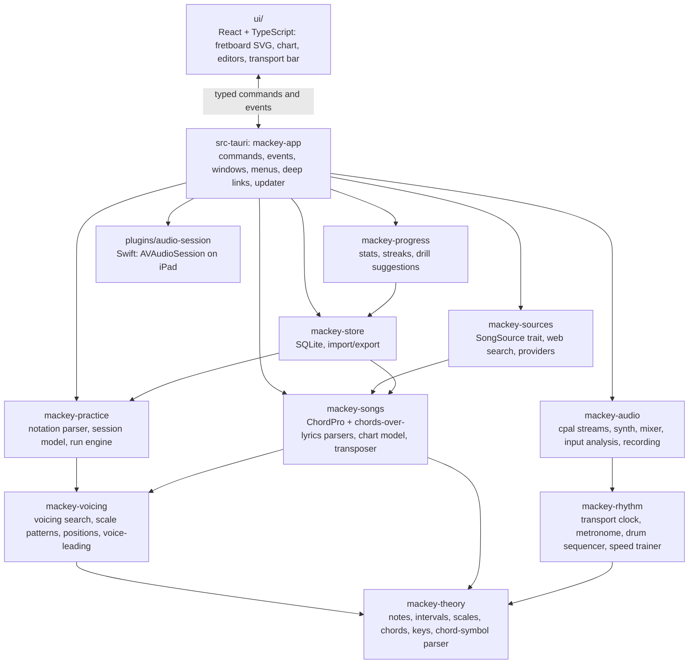
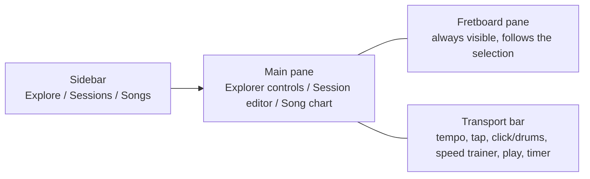
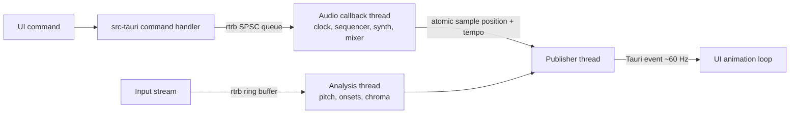

# Architecture

Status: Draft v0.2 (2026-11-15). Stack: Rust core, Tauri 2 shell, web UI. Targets: macOS (universal build) and iPad (Tauri iOS) from the start; see [platforms.md](platforms.md). Windows, Linux, iPhone and Android are deferred; the design keeps them possible but we do not build or test for them yet.

## 1. Technology choices

| Concern | Choice | Why | ADR |
|---------|--------|-----|-----|
| Core language | Rust (stable, 2024 edition) in a Cargo workspace | Strong types for music theory, safe and predictable real-time audio, portable if other platforms are added later | [0001](adr/0001-rust-core-tauri-shell.md) |
| App shell | Tauri 2 | One app for Mac (desktop) and iPad (iOS target) with the Rust backend in-process | 0001, [0008](adr/0008-ipad-via-tauri-ios.md) |
| UI | TypeScript, React, Vite; fretboard drawn in SVG | Mainstream skills, crisp scalable neck, built-in hit-testing and accessibility | [0007](adr/0007-web-ui-and-ipc-boundary.md) |
| UI to core boundary | Tauri commands and events; TypeScript types generated with ts-rs, command wrappers generated from an in-repo manifest | One source of truth for types, compile-time checked on both sides | 0007 |
| Modularity | One crate per domain; pure core crates with no I/O | Testable, reusable on mobile and in a CLI | [0002](adr/0002-pure-music-theory-core.md) |
| Persistence | SQLite (rusqlite, bundled) in the app container (`~/Library/Application Support/` on Mac, the app sandbox on iPad); plain text is the source of truth for sessions and songs | Portable data, zero setup | [0003](adr/0003-text-first-persistence.md) |
| Audio output and rhythm | cpal on CoreAudio (Mac and iPad) + rustysynth for guitar tones + a small one-shot sampler for CC0 drum kits ([sound-assets.md](sound-assets.md)); a Swift plugin sets up `AVAudioSession` on iPad; one sample-accurate transport clock | Native low latency without a web audio dependency; clean sound at any tempo | [0005](adr/0005-sequenced-drums.md) |
| Audio input | cpal input stream; McLeod/YIN pitch, onsets, chroma verification; ONNX Runtime (ort) model later | Offline, private, no backend | [0006](adr/0006-on-device-audio-analysis.md) |
| Song content | Local-only, user-initiated import; no scraping service | Legal and store-review risk | [0004](adr/0004-user-initiated-song-import.md) |
| Distribution | Mac: unsigned (ad-hoc signed) universal `.dmg` on GitHub Releases, no updater. iPad: Xcode install (free Apple ID or Developer Program). App Store later | Personal use for now | |
| Testing | `cargo test` with proptest (properties) and insta (golden files), criterion benchmarks; Vitest for UI logic; Playwright (WebKit; desktop, iPad landscape and portrait, and narrow viewports) against the UI with a mocked command layer that replays states recorded from the real Rust core (`src-tauri/src/bindings.rs` writes `ui/src/mocks/scenarios.json`, so the mocked UI shows real voicings and the UI never needs theory); a short manual smoke checklist on Mac and iPad per release (tauri-driver cannot drive WKWebView) | | |

## 2. Module layout



Rules:

- `mackey-theory`, `mackey-voicing`, `mackey-practice` and `mackey-songs` are pure: no I/O, no threads, no global state, deterministic. Parsers are pure functions from `&str` to a result with diagnostics. They contain nothing macOS-specific, so they would compile unchanged for other targets later.
- `mackey-rhythm` is pure scheduling logic (what happens at which sample). `mackey-audio` is the only crate that opens audio devices, and the only one that reads the microphone ([ADR 0006](adr/0006-on-device-audio-analysis.md)).
- Only `mackey-sources` touches the network.
- Platform-specific code is limited to `src-tauri` (windows, menus, pickers) and the Swift `audio-session` plugin on iPad; everything else is shared by Mac and iPad.
- `src-tauri` is a thin adapter: it maps commands to core calls, owns app state behind a mutex (never touched by the audio thread), and forwards events. No music logic lives there.
- The UI holds view state only. Anything a test should check (which frets to light, which voicing is chosen) is computed in Rust and sent to the UI as data.

## 3. Domain model

All core types are plain Rust values deriving `Clone, Debug, PartialEq, Eq, Hash, serde::Serialize/Deserialize` where meaningful, with TypeScript types generated for those that cross into the UI.

### 3.1 Music theory

```rust
pub struct PitchClass(u8);                                    // 0..=11, C = 0
pub struct Note { pub letter: Letter, pub accidental: i8 }    // spelled: F# != Gb
pub struct Pitch { pub note: Note, pub octave: i8 }           // MIDI-convertible
pub struct Interval { pub quality: IntervalQuality, pub number: u8 }  // M3, P5, m7
pub struct Scale { pub tonic: Note, pub mode: Mode }          // degrees() -> Vec<Note>
pub enum Mode { Major, NaturalMinor, HarmonicMinor, Dorian, Phrygian, Lydian, Mixolydian, Locrian,
                MajorPentatonic, MinorPentatonic, Blues }
pub struct Key { pub scale: Scale }                           // diatonic_chord(Degree::IV, Seventh::No)
pub struct ChordQuality { pub intervals: Vec<Interval>, pub symbol: &'static str }  // "m7b5"
pub struct Chord { pub root: Note, pub quality: ChordQuality, pub bass: Option<Note> }  // D/F#
pub fn parse_chord_symbol(s: &str) -> Result<Chord, ChordParseError>;
pub fn roman_to_chord(s: &str, key: &Key) -> Result<Chord, RomanParseError>;   // "vi" in G -> Em
```

Spelling matters: a beginner in F should see Bb, not A#. Keys own the spelling rules and every displayed note is spelled from its key.

### 3.2 Fretboard and voicings

```rust
pub struct Tuning { pub name: String, pub strings: Vec<Pitch> }   // low to high; presets: standard, drop_d, dadgad, open_g, ...
pub struct Instrument { pub tuning: Tuning, pub frets: u8, pub capo: u8 }
pub struct Handedness { pub mirrored: bool, pub low_string_on_top: bool }
pub struct FretPosition { pub string: u8, pub fret: u8 }
pub struct Voicing {
    pub chord: Chord,
    pub frets: Vec<Option<u8>>,      // per string, None = muted
    pub fingers: Vec<Option<u8>>,    // 1..=4, 0 = open
    pub kind: VoicingKind,           // Open, Caged(Shape), Triad { strings, inversion }, Arpeggio { position }
}
pub struct ScalePattern { pub scale: Scale, pub kind: PatternKind, pub positions: Vec<FretPosition> }  // pentatonic box 1..5, 3nps
pub enum Position { FretWindow(RangeInclusive<u8>), Caged(CagedShape) }
```

### 3.3 Practice sessions

```rust
pub struct PracticeSession {
    pub id: Uuid, pub name: String,
    pub source: String,                  // the quick-entry text, always the source of truth
    pub key: Option<Key>,
    pub items: Vec<PracticeItem>,        // derived by parsing `source`
    pub transitions: Vec<Transition>,    // items[i] -> items[i+1], with focus flag
    pub method: PracticeMethod,
    pub tempo: Option<Tempo>,            // bpm + meter
    pub backing: Option<BackingSettings>,// click or drum pattern, see rhythm.md
}
pub enum PracticeItemKind { Chord, Triad { inversion: Option<u8>, strings: Option<StringSet> },
                            Arpeggio { direction: Direction, position: Option<u8> }, Note }
pub struct PracticeItem { pub kind: PracticeItemKind, pub target: Target, pub duration: Duration, pub hint: Option<VoicingHint> }
pub struct Transition { pub from: usize, pub to: usize, pub is_focus: bool }
pub enum PracticeMethod { OneMinuteChanges { seconds: u16 }, SpeedTrainer(SpeedTrainer), Loop { times: Option<u16> },
                          Random, NameTheNote, Strum { pattern: String } }
pub struct PracticeRun { pub session_id: Uuid, pub date: DateTime<Utc>, pub tempo_reached: Option<u16>,
                         pub changes_per_minute: HashMap<TransitionKey, u16>, pub rating: Option<u8> }
```

### 3.4 Songs

```rust
pub struct Song {
    pub id: Uuid, pub title: String, pub artist: Option<String>,
    pub key: Option<Key>, pub capo: u8, pub tempo: Option<u16>, pub meter: Option<Meter>,
    pub tuning: Option<Tuning>,
    pub last_clean_tempo: Option<u16>,   // from the speed trainer
    pub sections: Vec<Section>,          // verse, chorus, bridge, or unnamed
    pub provenance: Provenance,          // Pasted, File(path), Web { url, fetched_at }, Provider { name, id }
    pub chordpro: String,                // canonical serialised form
}
pub struct Section { pub label: Option<String>, pub lines: Vec<Line> }
pub struct Line { pub lyrics: String, pub chords: Vec<ChordAnchor> }       // chord at character offset
pub struct ChordAnchor { pub offset: usize, pub symbol: String, pub chord: Option<Chord> }  // None = unparsed, user can fix
```

### 3.5 Persistence

SQLite tables wrap the text sources: `sessions(id, name, source, created_at, updated_at)`, `runs(session_id, date, start_tempo, end_tempo, clean_tempo, changes_per_minute_json, rating)`, `songs(id, title, artist, chordpro, provenance_json, voicing_overrides_json)`, `takes(...)` for looper recordings (audio files beside the database). Parsed models are rebuilt on load, so upgrading the parser upgrades every stored session without a migration. Schema migrations for the tables themselves use embedded SQL files run at start-up. Export is a folder of `.mackey` (notation) and `.cho` files.

## 4. Key algorithms

### 4.1 Voicing search (`mackey-voicing`)

Inputs: chord, instrument, constraints (string set, fret window, max span, allow open strings, inversion). Approach:

1. For each string, list frets within the window whose pitch class is a chord tone (or mute).
2. Depth-first search across strings with pruning: span ≤ 4 (configurable), at most 4 fretted notes (barre counts as one finger), required tones present (root and third; fifth optional), bass note matches inversion or slash bass.
3. Score each result: span, number of fingers, open strings bonus for beginners, root-in-bass bonus, string-skip penalty. Return the top N, sorted.
4. Curated shape library (open chords, CAGED barre shapes, triads) is checked first, so the common shapes are always exactly what a teacher would draw. Search fills the gaps.

Fingering: assign fingers by fret order within the window, with barre detection when the lowest fret repeats across strings.

### 4.2 Voice-leading path (songs and practice)

Given a chord sequence, choose one voicing per chord to minimise total movement. Model as a shortest path through a layered graph (layer = chord, node = candidate voicing). Edge cost = hand shift (difference in window start) + fingers that move + changes of string set, with a bonus for common tones held in place. Solved with dynamic programming (Viterbi), O(n x k²) with k ≈ 10 candidates per chord, which is instant. The user can pin a voicing; pinned layers have a single node.

### 4.3 Chords-over-lyrics detection (`mackey-songs`)

Classify each line as `chord`, `lyric`, `section header`, `tab`, or `blank`. A line is a chord line when at least about 80% of its whitespace-separated tokens parse as chord symbols (also allowing `|`, `x2`, `N.C.`, `/`). Chord lines are merged with the following lyric line by column offset. Full detail in [song-import.md](song-import.md).

### 4.4 Key detection

Score each of the 24 major/minor keys by how many song chords are diatonic, weighted by duration and by first/last chord. Show the top candidate with a confidence and let the user override.

## 5. UI composition and the core boundary



The fretboard is one shared component driven by one `FretboardView` value computed in Rust (instrument, handedness, highlighted positions with labels and colours, ghost positions, scale overlay). Every feature produces that value, so the neck behaves identically in explorer, practice and song views, and what the UI draws is fully testable in Rust.

Boundary between UI and core ([ADR 0007](adr/0007-web-ui-and-ipc-boundary.md)):

| Direction | Mechanism | Examples |
|-----------|-----------|----------|
| UI to core, request/response | Tauri commands (async, typed) | `parse_session(source)`, `voicings_for(chord, constraints)`, `import_song(text)`, `fretboard_view(selection)` |
| UI to audio, control | Command that pushes onto a lock-free queue to the audio thread | `transport_play`, `set_tempo`, `set_backing` |
| Core to UI, streaming | Tauri events | `transport_position` (about 60 Hz), `tuner_reading` (about 30 Hz), `run_progress` |

Parsing for the live editor preview runs as a command per keystroke (debounced to about 30 ms); the parsers are fast enough that this stays well under the 50 ms budget (NF-2).

## 6. Real-time audio design



- The cpal output callback is the clock. It never allocates, locks or blocks; all messages arrive through single-producer/single-consumer ring buffers (rtrb), and synth voices and patterns are pre-allocated.
- The UI does not use the event's arrival time. Each `transport_position` event carries sample position, tempo and the output latency; the UI's `requestAnimationFrame` loop extrapolates from the last event, so the playhead and chord changes stay smooth despite IPC jitter and line up with what the player hears.
- Device and latency: CoreAudio on both Mac and iPad (on iPad, after the audio-session plugin sets category, mode and buffer size). Default device, with a device picker for USB audio interfaces and a buffer-size setting. Anything macOS sees as a CoreAudio device works. (cpal also supports WASAPI, ASIO, ALSA and JACK, which is what keeps Windows and Linux possible later.)
- Analysis (tuner, onsets, chord verification) runs on its own thread from an input ring buffer, never in the audio callback.

## 7. Quality and engineering practice

- Theory and parser code test-first, with table-driven tests (every chord quality in every key, spelled correctly).
- **Property tests (proptest) for the theory engine:** transposing up then down is the identity; every interval added then subtracted returns the start note; a chord's pitch classes are the same in every voicing found; enharmonic spelling always matches the key's accidentals; voicing search never returns a voicing over the span limit or missing the root or third.
- **Golden-file tests (insta) for the parsers:** chord sheets and ChordPro in, normalised ChordPro and the parsed model out; practice notation in, parsed session and diagnostics out. Any change to output shows as a reviewable snapshot diff. ChordPro also has a round-trip property.
- A `fixtures/` corpus of chord sheets (written for the project or public domain) is the regression suite for the song parser, checked with insta snapshots.
- Criterion benchmarks guard the voicing search and parsers against regressions in the NF-1/NF-2 budgets.
- CI on GitHub Actions on `macos-latest`: `cargo fmt --check`, `cargo clippy -D warnings`, `cargo test --workspace`, UI lint, type check, Vitest and Playwright, then `tauri build` for a universal Mac binary and `tauri ios build` for the iOS simulator (an unsigned compile check). Tagged commits attach an ad-hoc signed `.dmg` to a GitHub Release. (The pure core crates can also run on a cheap Linux runner for speed; that is a CI convenience, not platform support.)
- A `CLAUDE.md` at the repo root with build/test commands and the crate rules above, so agentic contributors respect the layer boundaries.

## 8. As built: the fretboard foundation

Status: built 2026-11-15 on branch `claude/project-thread-e8va25` ([spec](../specs/261115-fretboard-foundation/spec.md), decisions D-01 to D-76+ in its [implementation notes](../specs/261115-fretboard-foundation/implementation-notes.md)). This section records what exists; sections 1 to 7 remain the design for the whole product.

### 8.1 Crates present

| Crate | Contents |
|---|---|
| `mackey-theory` | Notes, intervals, scales and modes, keys, chord qualities and the chord-symbol parser with diagnostics, Roman numerals and diatonic analysis, key-aware spelling. 99% line coverage; 30 properties |
| `mackey-voicing` | Tunings (nine presets and custom), capo, curated open and CAGED shapes, voicing search and scoring, fingering, triads, arpeggios, scale patterns (pentatonic boxes, three-notes-per-string), the selection model and cycling, `FretboardView`, the playback plan. Search about 0.3 ms, view under 1 ms |
| `mackey-audio` | MPM pitch detector, tuner state machine, Karplus-Strong synth (16 preallocated voices, allocation-free render), cpal glue for output and input |
| `mackey-app` (`src-tauri`) | State, 32 commands, one event, settings, logging |
| `xtask` | `archcheck`, `doccheck` |

`mackey-rhythm`, `mackey-practice`, `mackey-songs`, `mackey-store`, `mackey-progress` and `mackey-sources` do not exist yet; `src-tauri/plugins/audio-session` (Swift) is not written.

### 8.2 Commands and events

`src-tauri/src/commands.rs` has 32 thin commands; every body is an `AppState` method that runs without Tauri (so integration tests use a `FakeAudio`). Groups:

| Group | Commands |
|---|---|
| Explorer (return an `ExplorerSnapshot`) | `get_snapshot`, `select_key`, `select_diatonic_chord`, `select_chord`, `select_note`, `select_tuning`, `set_capo`, `set_view_type`, `set_labels_mode`, `set_scale_overlay`, `set_option`, `cycle` |
| Queries | `app_info`, `fretboard_view`, `parse_chord`, `voicings_for`, `fit_selection` |
| Audio | `play_selection`, `play_note`, `stop_playback` |
| Tuner | `list_input_devices`, `tuner_targets`, `tuner_start`, `tuner_stop`, `tuner_set_mode`, `tuner_reference_tone`, `open_system_settings` |
| Settings | `get_settings`, `set_settings`, `reset_settings`, `take_settings_notice` |

Commands take an optional `visible` fret range so the core can count notes beyond the view. One event, `tuner_reading` (about 30 Hz, from the analysis thread through a throttle), carries a `TunerReading`. Each snapshot has a revision number; the UI drops a response older than the last one it applied, so out-of-order replies never show a stale neck.

State: the explorer (selection, instrument, handedness, voicing cache), settings and audio sit behind three mutexes, always locked in that order and never by the audio thread. Every command body runs under `catch_unwind`; a panic becomes an `AppError` and the app keeps running.

### 8.3 Bindings

The types that cross the boundary derive `ts_rs::TS` in the core crates behind a `ts` feature. `tauri-specta` for Tauri 2 is still a release candidate, and `ts-rs` does not describe commands, so `src-tauri/src/manifest.rs` lists each command's argument names and TypeScript types once; `make bindings` turns it into `ui/src/bindings/commands.ts` (plus `events.ts` and the types), and a unit test keeps the manifest, the registered commands and the capability permissions in step. The same step records `ui/src/mocks/scenarios.json`: a state graph produced by driving the real `AppState` through scripted scenarios, which the mocked UI replays. `make bindings-check` fails when any generated file is stale. See [ADR 0007](adr/0007-web-ui-and-ipc-boundary.md).

### 8.4 Settings storage (a stopgap)

`mackey-store` does not exist yet, so settings are one `settings.json` in the app data folder (`~/Library/Application Support/dev.stainedhead.mackey/` on a Mac): a `version` field, `#[serde(default)]` groups so older files load, unknown fields ignored, an atomic write (temp file then rename), a corrupt file moved aside as `settings.json.bak-<time>` with a one-time notice, and values clamped on load. It moves into SQLite when `mackey-store` lands ([ADR 0003](adr/0003-text-first-persistence.md)); the group layout is the migration source. Logs go to `logs/mackey.log` beside it, rotated daily, three kept.

### 8.5 UI

`ui/src` holds the layout shell (sidebar on wide windows, tabs on iPad portrait), the Explore screen (toolbar, chord strip and field, view controls, voicing list with mini diagrams), the shared SVG `Fretboard` with `FretboardPanel` (scroll frame, range controls, gestures, and an edge-arrow bar above the neck for notes beyond the view), the Tuner and Settings screens, an `ipc/` layer that picks the real or mocked commands, and `state/` (a store with last-revision-wins). It computes no music. Tests: Vitest (jsdom) and Playwright in WebKit against the mocked layer; screenshots of the real app come from `make screenshots` (Linux, optional).

