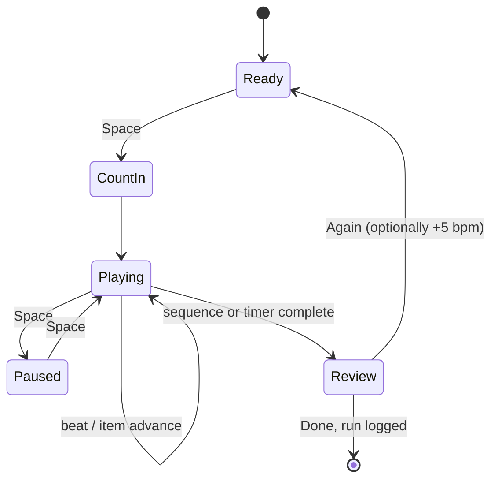

# Practice Sessions

Status: Draft v0.2 (2026-11-15). Requirements, defaults and error messages are in [PRD 04](prd/04-practice.md); this doc holds the design and the grammar. If they differ, the PRD wins.

## 1. Goal

A player preparing a song should be able to describe what they want to drill in a few seconds of typing, then press Space and practice. Entry has to be faster than clicking through menus, and readable enough that a teacher can text it to a student.

## 2. Quick-entry notation

### 2.1 Examples

```text
key G; G > Em >> C > D x4 @changes 60s
```
G major. Cycle G, Em, C, D four times. The Em to C change is a focus transition. Method: one-minute changes.

```text
key C; I > vi > IV > V @ladder 60-100 +5 pass drums:pop
```
Roman numerals, resolved in the key (C, Am, F, G). Speed trainer from 60 to 100 bpm, up 5 after each clean pass, over a pop drum groove.

```text
key A minor; Am:tri str123 > Dm:tri str123 inv1 > E:tri str123 inv2 @loop
```
Triads on the top three strings with chosen inversions: a "minimal movement" drill.

```text
Am:arp pos5 up > C:arp pos5 up > G:arp pos3 updown @ 80bpm 8ths
```
Arpeggios in a position, with direction and subdivision.

```text
key E; n:E n:G# n:B n:C# @name random
```
Find-the-note drill: the app names a note and the player finds every place it occurs (or the app shows a fret and the player names it).

```text
"Chorus" (G > D > Em > C) x2 | "Bridge" Am7 >> D7 @strum D-DU-UDU 90bpm
```
Labelled groups, bar separator, strum pattern.

### 2.2 Grammar (EBNF)

```ebnf
session     = [ header ";" ] sequence [ method ] ;
header      = "key" ws keyname { ";" setting } ;
keyname     = note [ "m" ] [ ws mode ] ;         (* "G", "Em", "A minor", "D dorian", "A harmonic minor" *)
setting     = "capo" int | "tempo" int | "time" int "/" int | "tuning" word ;   (* tuning names in PRD 04 PS-1.3 *)

sequence    = step { transition step } ;
transition  = ">" | ">>" | "|" ;                 (* normal, focus change, bar line (normal) *)
step        = [ label ] ( item | group ) [ repeat ] [ duration ] ;
group       = "(" sequence ")" ;
label       = '"' text '"' ;
repeat      = "x" int ;
duration    = int ( "b" | "bar" | "bars" ) ;     (* beats or bars on this item, default 1 bar *)

item        = target [ ":" kind ] { ws modifier } ;
target      = chordsymbol | roman | "n:" note [ int ] ;     (* n:A = every A, n:A2 = one pitch *)
roman       = [ "b" | "#" ] numeral [ "°" | "o" | "ø" | "+" | "7" | "maj7" | "m7" ] [ "/" roman ] ;
numeral     = "I" | "II" | "III" | "IV" | "V" | "VI" | "VII" | "i" | "ii" | "iii" | "iv" | "v" | "vi" | "vii" ;
kind        = "chord" | "tri" | "arp" ;           (* default chord *)
modifier    = "str" digits                        (* string set, e.g. str123 = strings 1-3, 1 = high E *)
            | "inv" ( "0" | "1" | "2" | "3" )
            | "pos" int                           (* start fret of the position window *)
            | "open" | "barre" | "caged:" ( "C" | "A" | "G" | "E" | "D" )
            | "up" | "down" | "updown" ;          (* arpeggio direction *)

method      = "@" methodname { ws param } { ws backing } ;
methodname  = "changes" | "ladder" | "loop" | "random" | "name" | "strum" ;
param       = int "s" | int "bpm" | int "-" int | "+" int | "-" int "miss" | advance | subdivision | pattern
            | "show" | "find" | "random" ;                (* name-the-note options *)
pattern     = { "D" | "U" | "-" | "x" } ;
advance     = "pass" | "clean" | int "bars" ;          (* speed-trainer advance rule, default clean *)
backing     = "click" [ ws subdivision ] [ ws "gap:" int ]
            | "drums:" style [ "/" variation ] [ ws "fills:" int ]
            | "nodrums" | "noclick" ;
subdivision = "4ths" | "8ths" | "16ths" | "triplets" | "swing" ;
```

Notes on the grammar:

- Whitespace is free, keywords are case-insensitive, chord symbols are case-sensitive (`Em` vs `EM` is ambiguous, so `EM` gives a warning).
- Chord symbols use the same `ChordSymbolParser` as songs, so anything a song chart accepts is valid here.
- `>>` marks the transition *into* the next step as a focus change.
- Backing defaults to a click at the session tempo. `drums:` styles and variations are listed in [rhythm.md §3](rhythm.md#3-drum-backing).
- Unknown tokens never block. They are underlined with a hint and the rest of the session still runs (the parser recovers at the next `>`).

### 2.3 Editor experience

- One-line text field with live preview underneath: a row of chips (one per item, focus transitions drawn as thick arrows) and the fretboard showing the item under the cursor.
- Autocomplete for chord qualities, modifiers and method names; Tab accepts.
- A "Build" button opens a structured form (pick chords from the key's diatonic palette, toggle focus arrows, choose a method) that **writes notation**, so beginners learn the shorthand by watching it fill in.
- Sessions save as their notation text, so copy/paste into Messages or email just works.

## 3. Practice methods

| Method | Notation | How the run works | What we record |
|--------|----------|-------------------|----------------|
| One-minute changes | `@changes 60s` | Alternate between the two chords of each transition (focus ones first) for N seconds; player taps Space on each clean change, or count manually | Changes per minute per transition, trend over time |
| Speed trainer | `@ladder 60-100 +5 pass` | Start slow; raise tempo by the step every pass, every N bars, or on each clean pass (Return), until target. `-5 miss` steps back on a miss. Click and drums follow | Highest clean tempo, tempo over time |
| Loop | `@loop` / `@loop 8` | Repeat the sequence with metronome and count-in | Minutes practised |
| Random order | `@random` | Items in shuffled order; next item revealed one bar early | Minutes practised, self-rating |
| Name the note | `@name` | App shows a fret, player names the note, or app names a note and player clicks all its positions | Accuracy, response time |
| Strum pattern | `@strum D-DU-UDU` | Pattern displayed above the beat grid, strokes clicked with the metronome | Minutes, tempo |

Focus transitions get double time in `changes`, appear twice as often in `random`, and are shown with a highlighted arrow in every mode.

## 4. Run mode



Screen during a run:

- Fretboard shows the **current** item in full colour and the **next** item ghosted, with fingers that stay put marked as anchors ("keep finger 3 on the 3rd fret").
- Beat grid with a playhead, current/next chips, timer, tempo control (Up/Down arrows, ±5 bpm, T to tap), speed-trainer progress ("72 of 96 bpm"), and click/drums toggle (D).
- Shortcuts: Space play/pause, Return mark a clean change, ←/→ step, R restart, Esc exit.

Timing comes from the shared `TransportClock` in `mackey-rhythm` ([rhythm.md §5.1](rhythm.md#51-one-clock-many-listeners)). The UI follows the audio clock rather than a UI timer, so the visual change lines up with the click.

## 5. From songs and the explorer

- **From a song:** the chord progression of each section becomes a labelled group; repeated sections collapse to `xN`. Transitions are scored by the voice-leading cost from [architecture.md §4.2](architecture.md#42-voice-leading-path-songs-and-practice); the top 2 or 3 hardest become `>>` focus changes. Voicings chosen in the song view carry over as modifiers (`pos`, `str`, `inv`).
- **From the explorer:** "Practice this" on any selection (a chord's inversions, a triad cycle, an arpeggio in a position) emits the matching notation.

## 6. Acceptance examples

| Input | Expected |
|-------|----------|
| `key G; G > Em >> C > D x4 @changes 60s` | 4 items, 3 transitions, Em→C focus, method changes(60), sequence repeats 4 |
| `key C; ii > V > I` | Dm, G, C |
| `key F; IV` | Bb (spelled Bb, not A#) |
| `C:tri str234 inv1` | Notes E-G-C on strings 4-3-2 at frets 2-0-1 |
| `key G; G > C @ladder 60-90 +5 clean drums:rock/chorus` | Speed trainer 60 to 90 step 5 on clean pass, rock chorus groove |
| `G > Hm7 > C` | Warning on `Hm7` (unknown chord), session still runs with G and C |
