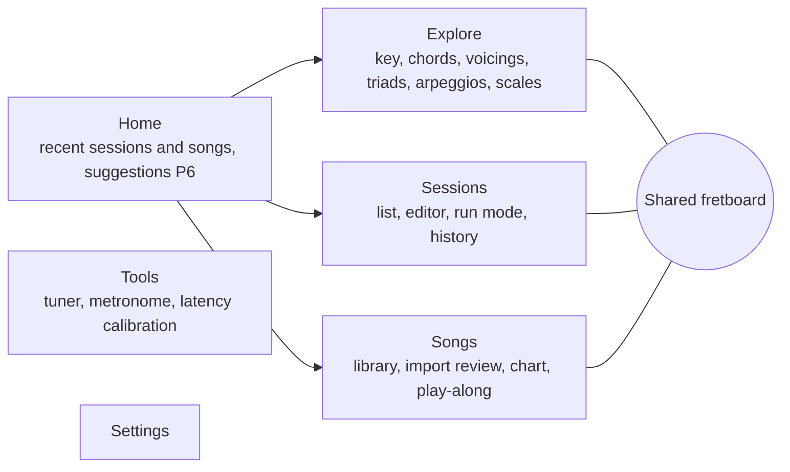

# 07. UX: Navigation, Layouts, Flows, Shortcuts and Gestures

Applies to all phases. Platform notes: [platforms.md](../platforms.md).

## 1. Information architecture

- UX-1 Top-level areas: Home, Explore, Sessions, Songs, Tools (Tuner), Settings. On Mac these are a sidebar; on iPad a sidebar in landscape and a tab bar in portrait.
- UX-2 The shared fretboard and the transport bar are present in Explore, Sessions and Songs. The tuner replaces the main content but keeps the sidebar.
- UX-3 Every screen state is reachable in at most 3 actions from Home.

## 2. Layouts

### UX-4 Mac (window minimum 900 × 600 px; default 1280 × 800)

| Region | Content |
|--------|---------|
| Toolbar | Key picker, tuning and capo, labels mode, view type, search |
| Sidebar (220 px, collapsible, `Cmd-0`) | Areas, then the list for the current area |
| Main | Explore controls, session editor, or song chart |
| Neck pane | Below Main by default (resizable split); can move to the right for wide windows (≥ 1600 px) |
| Transport bar | Bottom, full width, 48 px |

- UX-4.1 Windows remember size, split position and area. Multiple windows are allowed (File > New Window), each with its own selection and transport; only one transport may play at a time (starting one pauses the others).
- UX-4.2 Menus mirror every command with its shortcut (§4).

### UX-5 iPad

| Orientation | Layout |
|-------------|--------|
| Landscape (default) | Sidebar (collapsible) · main content · neck across the bottom 40% · transport bar |
| Portrait | Tab bar · main content top half · neck bottom half (shows 7 frets, scrolls horizontally) · transport bar |
| Split View / Slide Over, narrow | Sidebar hidden; main and neck stacked; neck scrolls |

- UX-5.1 Tap targets at least 44 × 44 pt. The neck's fret cells meet this at default zoom in landscape; pinch zooms the neck between 5 and 24 visible frets.
- UX-5.2 Every hover interaction on Mac has a tap or long-press equivalent on iPad (tooltip = long-press; chart chord preview = tap).
- UX-5.3 With a hardware keyboard, all Mac shortcuts work with the same keys, and holding Cmd shows the iPadOS shortcut overlay.

## 3. Key flows

### Flow F-1 First launch

1. Welcome screen: one sentence of purpose and "Get started".
2. Choose: Right-handed / Left-handed (with a neck preview); tuning (Standard pre-selected).
3. Optional: "Tune up first?" opens the tuner (and the microphone permission explanation, E-TU-1).
4. Land in Explore with G major key notes shown and a dismissible 3-step tip ("Pick a chord", "Use the arrow keys / swipe to cycle", "Press Space to hear it").

Acceptance: from launch to seeing G major on the neck in at most 3 taps or clicks.

### Flow F-2 Explore a chord

1. Explore → pick key → tap IV in the chord strip → neck shows open C (if key G).
2. → swipe/arrow through voicings → choose Triad view → change string set and inversion → Play.

### Flow F-3 Quick practice

1. Sessions → "+" (`Cmd-N`) → type `G > Em >> C > D @changes 60s` → Enter.
2. Count-in → run → Return on each clean change → Esc → Review → Done.

Acceptance: a practised user completes steps 1 to 2's start in under 10 seconds (manual timed check).

### Flow F-4 Song from a pasted sheet

1. Copy a chord sheet in the browser → Songs → `Cmd-Shift-V` (or Paste) → Import review.
2. Fix any unparsed chords (Next unparsed) → Save.
3. Chart → tap chords to see them → apply capo suggestion if offered → Play-along at 70% tempo with drums.
4. "Practice this song" → session runs with the speed trainer.

### Flow F-5 Tune up

Tools → Tuner (`Cmd-T`) → play each string until all six show a tick → Close returns to where the player was.

### Flow F-6 Speed-trainer workout

From any session or song: transport bar → Speed trainer → set start/target/step → Play → Return on clean passes until "Target reached".

## 4. Keyboard shortcuts (Mac, and iPad with a keyboard)

| Area | Action | Shortcut |
|------|--------|----------|
| Global | New session | `Cmd-N` |
| Global | New song from clipboard | `Cmd-Shift-V` |
| Global | Open file | `Cmd-O` |
| Global | Find | `Cmd-F` |
| Global | Tuner | `Cmd-T` |
| Global | Settings | `Cmd-,` |
| Global | Undo / Redo | `Cmd-Z` / `Cmd-Shift-Z` |
| Global | Toggle sidebar | `Cmd-0` |
| Global | Areas: Home, Explore, Sessions, Songs | `Cmd-1` to `Cmd-4` |
| Transport | Play / pause | `Space` |
| Transport | Stop | `Esc` |
| Transport | Tempo −1 / +1 / −5 / +5 | `-` / `=` / `Shift--` / `Shift-=` |
| Transport | Tap tempo | `T` |
| Transport | Click on/off | `K` |
| Transport | Drums on/off | `D` |
| Explore | Chord down / up the key | `↓` / `↑` |
| Explore | Voicing next / previous | `→` / `←` |
| Explore | Inversion next / previous | `I` / `Shift-I` |
| Explore | String set next / previous | `S` / `Shift-S` |
| Explore | Position next / previous | `P` / `Shift-P` |
| Explore | View type | `V` |
| Explore | Labels | `L` (in Explore; in a song chart, `L` loops the section) |
| Explore | Scale overlay | `O` |
| Explore | Key next / previous (circle of fifths) | `]` / `[` |
| Explore | Relative major/minor | `R` (outside run mode) |
| Run mode | Clean / Miss | `Return` / `Backspace` |
| Run mode | Restart | `R` |
| Run mode | Previous / next item (paused) | `←` / `→` |
| Songs | Transpose down / up | `Cmd-↓` / `Cmd-↑` |
| Songs | Move chord left / right (editor) | `Alt-←` / `Alt-→` |
| Songs | Insert chord (editor) | `[` |

- UX-6 Single-key shortcuts are disabled while a text field has focus.
- UX-7 Conflicts are resolved by area: a key has one meaning per area, listed above; tests check that no two commands in the same area share a shortcut.

## 5. iPad gestures

| Gesture | Where | Action |
|---------|-------|--------|
| Tap | Neck position | Show tooltip; play the note |
| Long-press | Neck position | Pin tooltip with details |
| Swipe left / right | Neck | Next / previous voicing (or item in a paused run) |
| Two-finger swipe left / right | Neck | Next / previous position |
| Pinch | Neck | Zoom visible fret range |
| Swipe up / down | Chord strip | Next / previous chord in key |
| Long-press and drag | Chord in editor | Move chord along the lyric |
| Two-finger tap | Anywhere in run mode | Mark clean |
| Three-finger swipe left | Anywhere | Undo (system) |

## 6. Empty, loading and notice states

- UX-8 Each list has an empty state with one clear action: Sessions ("Type your first session" + example), Songs ("Paste a chord sheet" + "Open a ChordPro file"), History ("Your runs will appear here").
- UX-9 Long operations over 300 ms (library export, large import) show progress; nothing in normal use blocks input.
- UX-10 Notices are brief banners (3 s, or until dismissed for errors) and are announced to VoiceOver. Destructive actions ask for confirmation, except delete-to-Recently-deleted, which offers Undo instead.
