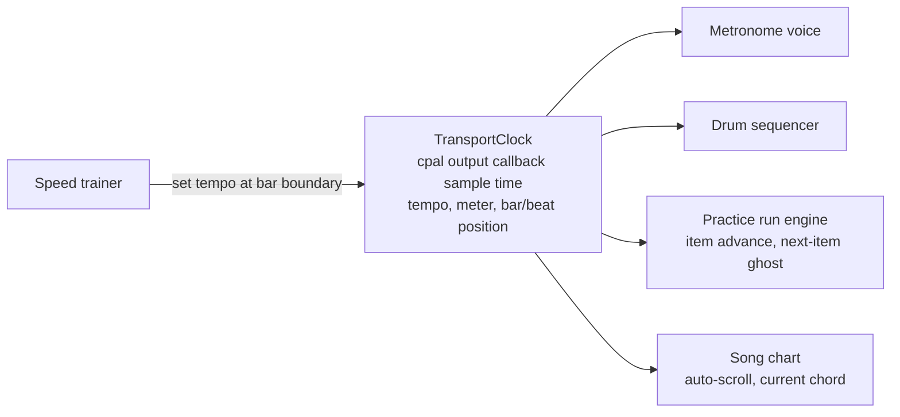

# Rhythm: Metronome, Drum Backing and Speed Trainer

Status: Draft v0.2 (2026-11-15). Requirements are specified in full in [PRD 03](prd/03-rhythm.md); the tables below summarise them for design context. If they differ, the PRD wins.

## 1. Goal

Help the player lock into a steady cadence. Both the metronome and the drum backing run at an adjustable tempo, so the player can start slow and step up to the song's real speed as they master it. Rhythm is a shared service: the explorer, practice sessions and song charts all use the same clock.

## 2. Metronome

| ID | Requirement |
|----|-------------|
| RH-1 | Tempo 30 to 250 bpm, adjustable by slider, ±1/±5 keys, typed value, and **tap tempo** (mean of the last 4 taps). |
| RH-2 | Time signatures 2/4, 3/4, 4/4, 5/4, 6/8, 7/8, 9/8, 12/8, with accent on beat 1 and configurable groupings (e.g. 2+2+3 for 7/8). |
| RH-3 | Subdivisions: quarters, 8ths, triplets, 16ths, swing 8ths (swing amount adjustable). |
| RH-4 | Click sounds (wood block, beep, cowbell, voice count "1, 2, 3, 4"), separate volume for accent and subdivision. |
| RH-5 | Count-in of 1 or 2 bars before any run. |
| RH-6 | Visual pulse (beat dots, flashing border) for when the sound is off or the player uses headphones on an amp. |
| RH-7 | Optional "gap click": the metronome drops out for N bars and comes back, so the player can check they kept time. |

## 3. Drum backing

| ID | Requirement |
|----|-------------|
| DR-1 | Built-in pattern library by style: rock, pop, ballad, folk/strum, country (train beat), shuffle/blues, funk, reggae, bossa nova, waltz (3/4), 6/8 ballad, half-time. Each style has 2 to 4 variations (e.g. verse, chorus). |
| DR-2 | Tempo follows the shared clock, so drums speed up or slow down with no change in pitch or sound quality. |
| DR-3 | Fills every 4 or 8 bars (on/off), and a crash on the downbeat after a fill. |
| DR-4 | Intensity control (sparse, normal, full) that thins or adds parts. |
| DR-5 | Mixer: drums volume, click on/off over drums, per-part mute (kick, snare, hats) for "play along with just the kick" drills. |
| DR-6 | In song view, a section can be given a variation (verse groove vs chorus groove) and the drummer follows the chart's sections. |
| DR-7 | Later: user-defined patterns in a simple text grid (see §5.2), and import of standard MIDI drum files. |

## 4. Speed trainer (start slow, build up)

The speed trainer is what makes "start slow, move up to the correct speed" automatic. It drives the tempo of the metronome and drums together.

| ID | Requirement |
|----|-------------|
| ST-1 | Set **start**, **target** and **step** tempo (e.g. 60 to 96, +4). Target defaults to the song's tempo when known. |
| ST-2 | Advance rule: after every N bars, after every full pass of the sequence, or only when the player marks a clean pass (Return). |
| ST-3 | Optional **step back**: if the player marks a miss, drop one step. |
| ST-4 | Show progress as "72 of 96 bpm (75%)" and a small tempo-over-time chart per session and per song. |
| ST-5 | Remember the **last clean tempo** per session and per song, and offer to start the next run a step or two below it. |

This replaces the earlier standalone tempo-ladder method: `@ladder` in practice notation is now the speed trainer.

## 5. Design

### 5.1 One clock, many listeners



- `TransportClock` lives in the `mackey-rhythm` crate and is advanced by the audio callback in `mackey-audio` (Rust, on CoreAudio via cpal). It schedules events with sample-accurate offsets inside each audio buffer, so clicks and drum hits are sample-accurate whatever the UI is doing.
- Tempo changes apply on the next bar line, so a step-up never lands mid-bar.
- UI listeners (fretboard, chart) in the web UI are driven from the clock position the core streams to them (with tempo and latency), extrapolated per animation frame, not from their own timers, so what you see and what you hear stay together. See [architecture.md §6](architecture.md#6-real-time-audio-design).
- Output latency compensation: a user setting (and an automatic estimate from the audio device) shifts visuals to match what the player hears, which matters with Bluetooth headphones (AirPods add well over 100 ms).

### 5.2 Drum patterns are data, not audio loops

Patterns are step sequences played through freely licensed multi-sampled drum kits by a small one-shot sampler inside the audio callback, mapped to General MIDI drum notes ([sound-assets.md](sound-assets.md)). Because hits are synthesized, any tempo from 30 to 250 bpm sounds clean: no time-stretching artefacts. See [ADR 0005](adr/0005-sequenced-drums.md).

Pattern definition (bundled as JSON, also the user-pattern format later):

```text
style: rock   variation: verse   meter: 4/4   steps: 16   swing: 0
kick : x . . . . . . . x . x . . . . .
snare: . . . . x . . . . . . . x . . .
hat  : x . x . x . x . x . x . x . x .
fill : every 8 bars -> rock-fill-1
```

Step values: `x` normal, `X` accent, `g` ghost note, `.` rest. Velocity humanisation (small random variation) and an optional tiny timing push/pull keep it from sounding mechanical.

### 5.3 Model

```rust
pub struct Tempo { pub bpm: f64, pub meter: Meter, pub subdivision: Subdivision, pub swing: f32 }
pub struct MetronomeSettings { pub sound: ClickSound, pub accent_volume: f32, pub subdivision_volume: f32, pub count_in_bars: u8, pub gap: Option<GapPattern> }
pub struct DrumPattern { pub id: String, pub style: Style, pub variation: String, pub meter: Meter, pub steps: u8,
                         pub tracks: BTreeMap<DrumVoice, Vec<Step>>, pub fill: Option<FillRule> }
pub struct BackingSettings { pub pattern: Option<String>, pub intensity: Intensity, pub fills_every: Option<u8>,
                             pub mutes: BTreeSet<DrumVoice>, pub click_over_drums: bool }
pub struct SpeedTrainer { pub start: u16, pub target: u16, pub step: u16, pub advance: AdvanceRule, pub step_back_on_miss: bool }
pub enum AdvanceRule { EveryBars(u16), EveryPass, OnCleanPass }
```

Songs store `tempo`, `meter` and an optional per-section `drumVariation` as ChordPro metadata (`{tempo: 96}`, `{time: 4/4}`, plus a custom `{x_mackey_drums: rock/chorus}` directive, which other ChordPro tools ignore safely).

## 6. Practice notation additions

```text
key G; G > Em >> C > D x4 @ladder 60-96 +4 pass drums:rock
key D; D > A > Bm > G @loop 80bpm drums:shuffle/full fills:4
Am > Dm > E7 @changes 60s click 8ths
key C; C > G > Am > F @loop 70bpm click gap:2
```

See the grammar in [practice-sessions.md §2.2](practice-sessions.md#22-grammar-ebnf).

## 7. Acceptance checks

- At 60, 120 and 240 bpm the click drifts less than 1 ms over 10 minutes against the audio sample clock.
- A speed-trainer step from 72 to 76 bpm takes effect exactly on the next bar line.
- Drums at 40 bpm and 200 bpm play the same samples with no pitch change.
- With 150 ms latency compensation set, the fretboard's chord change lands with the audible downbeat.
