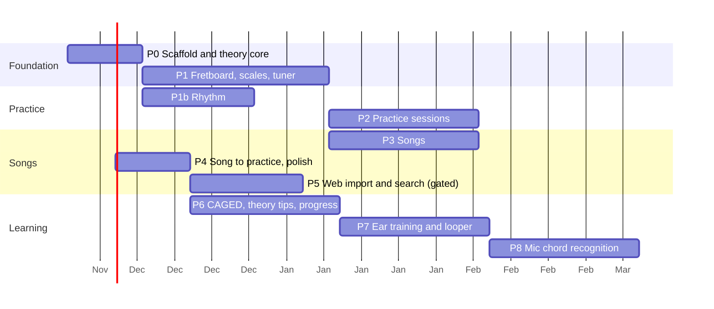

# Roadmap

Status: Draft v0.1 (2026-11-15). Phases are sized for one developer working with coding agents; each phase ends in a usable build.

P1b (rhythm) needs only the P0 scaffold, so it runs alongside P1. P2 and P3 can run in parallel once P1 is done; they share the theory, voicing and rhythm layers.

## P0: Scaffold and theory core (2 weeks)

- Xcode project, local Swift packages per [architecture.md §2](architecture.md#2-module-layout), CI, SwiftLint, `CLAUDE.md`.
- `MusicTheory`: notes with spelling, intervals, scales and modes, keys, chord qualities (triads, sevenths, sus, add, 6, 9, slash), `ChordSymbolParser`, Roman numerals.
- **Exit:** table-driven tests for every chord quality in all 12 keys spelled correctly; parser accepts the symbol variants in [song-import.md §4.3](song-import.md#43-chords-over-lyrics).

## P1: Fretboard explorer, scales, tunings and tuner (5 weeks), covers FB-1 to FB-9, SC-1 to SC-5, LH-1 to LH-5, TU-1 to TU-5

- `FretboardUI` Canvas view, labels mode, left-handed, tunings, capo.
- `VoicingEngine`: curated open and CAGED shapes, triad search on string sets, arpeggio-in-position, scoring.
- Cycling controller with keyboard shortcuts; sampler playback.
- Scale and mode overlays with pentatonic boxes; left-handed and string-flip views; tuning presets and custom tunings, with every shape recomputed per tuning.
- `AudioInputKit` v1: microphone permission flow and the tuner.
- **Exit:** a beginner can pick G major, step I to vii°, and for each see open shape, CAGED shapes, triads on each string set and an arpeggio in position, at 60 fps, in any supported tuning, left- or right-handed; A minor pentatonic box 1 to 5 cycles cleanly; the tuner reads within ±3 cents.

## P1b: Rhythm, metronome and drum backing (3 weeks), covers RH-1 to RH-7, DR-1 to DR-6, ST-1 to ST-5

- `RhythmKit`: `TransportClock` on the audio timeline, metronome voices, step sequencer with a General MIDI drum SoundFont, starter pattern library (about 12 styles with variations and fills), speed trainer, latency compensation.
- Transport bar UI with tap tempo, click/drums mixer and speed-trainer progress, usable from the explorer.
- **Exit:** acceptance checks in [rhythm.md §7](rhythm.md#7-acceptance-checks) pass; a player can pick a style, set 60 to 96 bpm +4 per 8 bars and play along.

## P2: Practice sessions (4 weeks), covers PS-1 to PS-8

- Notation parser with recovery and diagnostics; live-preview editor with autocomplete; "Build" form that writes notation.
- Run engine on the audio clock: metronome, count-in, current/next fretboard with anchors.
- Methods: changes, speed trainer (from RhythmKit), loop, random, name-the-note, strum, each with click or drum backing. Run logging and per-transition history.
- **Exit:** all acceptance examples in [practice-sessions.md §6](practice-sessions.md#6-acceptance-examples) pass; a session can be typed and running in under 10 seconds.

## P3: Songs, paste and ChordPro (4 weeks), covers SG-1, SG-2, SG-5 to SG-8, SG-10

- `SongKit`: ChordPro parser/serialiser, chords-over-lyrics classifier and aligner, import review screen.
- Chart view, drums that follow song sections, speed trainer toward the song tempo, chord palette, voice-leading voicing set, transpose, capo, key detection, auto-scroll.
- Starter library of public-domain songs.
- **Exit:** fixture corpus parses with ≥ 98% of chords correctly placed; round-trip tests pass.

## P4: Song to practice, polish (2 weeks), covers SG-9

- "Practice this song" with hardest-transition detection.
- Accessibility pass, onboarding, export/import of library.

## P5: Web import and search (3 weeks, gated), covers SG-3, SG-4

- **Gate:** legal review of [song-import.md §2](song-import.md#2-legal-and-terms-of-service-constraints-read-first) and a distribution decision (App Store vs direct).
- Share extension (selected text first, page second), local HTML extraction, search results opening in the browser.
- `SongSource` provider protocol, ready for a licensed provider.

## P6: CAGED maps, theory tips, progress (4 weeks), covers CG-*, TT-*, PR-*

- CAGED shape map with linked arpeggios and pentatonic boxes; position map for a fret window.
- Theory facts engine and tips panel.
- `ProgressKit`: dashboard, streaks with weekly goals, per-transition trends, drill suggestions.

## P7: Ear training and looper (4 weeks), covers ET-*, LP-*

- Interval, chord-quality and progression drills (graded by clicking the fretboard until P8).
- Record over the backing with latency compensation, loop playback, onset timing view.

## P8: Chord and note recognition by microphone (4 weeks), covers MR-*

- Expected-chord verification from chroma templates; auto-counted clean changes; ear-training "play it back" grading.
- **Exit:** at least 90% correct verdicts on a recorded test set of acoustic and electric chords, with false "correct" under 5%.

## Later

User-defined drum patterns and MIDI drum file import (DR-7), iPad build, iCloud sync, teacher sharing, bass and 7-string, spaced repetition across sessions, Core ML chord model.
