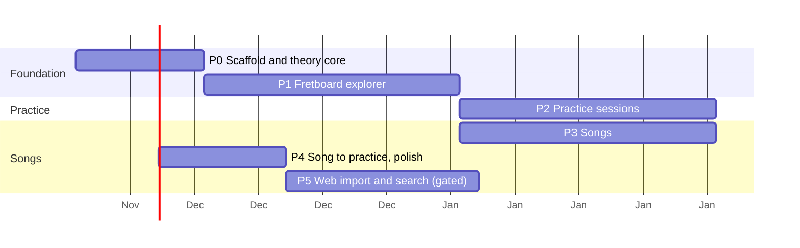

# Roadmap

Status: Draft v0.1 (2026-11-15). Phases are sized for one developer working with coding agents; each phase ends in a usable build.

P2 and P3 can run in parallel once P1 is done; they share only the theory and voicing layers.

## P0: Scaffold and theory core (2 weeks)

- Xcode project, local Swift packages per [architecture.md §2](architecture.md#2-module-layout), CI, SwiftLint, `CLAUDE.md`.
- `MusicTheory`: notes with spelling, intervals, scales and modes, keys, chord qualities (triads, sevenths, sus, add, 6, 9, slash), `ChordSymbolParser`, Roman numerals.
- **Exit:** table-driven tests for every chord quality in all 12 keys spelled correctly; parser accepts the symbol variants in [song-import.md §4.3](song-import.md#43-chords-over-lyrics).

## P1: Fretboard explorer (4 weeks), covers FB-1 to FB-9

- `FretboardUI` Canvas view, labels mode, left-handed, tunings, capo.
- `VoicingEngine`: curated open and CAGED shapes, triad search on string sets, arpeggio-in-position, scoring.
- Cycling controller with keyboard shortcuts; sampler playback.
- **Exit:** a beginner can pick G major, step I to vii°, and for each see open shape, CAGED shapes, triads on each string set and an arpeggio in position, at 60 fps.

## P2: Practice sessions (4 weeks), covers PS-1 to PS-8

- Notation parser with recovery and diagnostics; live-preview editor with autocomplete; "Build" form that writes notation.
- Run engine on the audio clock: metronome, count-in, current/next fretboard with anchors.
- Methods: changes, ladder, loop, random, name-the-note, strum. Run logging and per-transition history.
- **Exit:** all acceptance examples in [practice-sessions.md §6](practice-sessions.md#6-acceptance-examples) pass; a session can be typed and running in under 10 seconds.

## P3: Songs, paste and ChordPro (4 weeks), covers SG-1, SG-2, SG-5 to SG-8, SG-10

- `SongKit`: ChordPro parser/serialiser, chords-over-lyrics classifier and aligner, import review screen.
- Chart view, chord palette, voice-leading voicing set, transpose, capo, key detection, auto-scroll.
- Starter library of public-domain songs.
- **Exit:** fixture corpus parses with ≥ 98% of chords correctly placed; round-trip tests pass.

## P4: Song to practice, polish (2 weeks), covers SG-9

- "Practice this song" with hardest-transition detection.
- Accessibility pass, onboarding, export/import of library.

## P5: Web import and search (3 weeks, gated), covers SG-3, SG-4

- **Gate:** legal review of [song-import.md §2](song-import.md#2-legal-and-terms-of-service-constraints-read-first) and a distribution decision (App Store vs direct).
- Share extension (selected text first, page second), local HTML extraction, search results opening in the browser.
- `SongSource` provider protocol, ready for a licensed provider.

## Later

Pitch and chord detection from the microphone, iPad build, iCloud sync, teacher sharing, bass and 7-string, scales and pentatonic boxes, spaced repetition across sessions.
