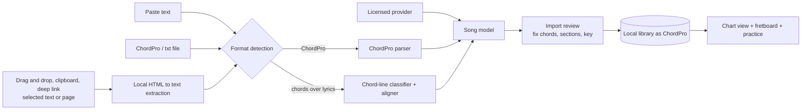

# Songs: Search, Import and Parsing

Status: Draft v0.1 (2026-11-15)

## 1. Goal

Let a player get a song's chords and lyrics into the app, see a clean chart, and get fretboard help for every chord, without the app becoming an unlicensed lyrics or tab distributor.

## 2. Legal and terms-of-service constraints (read first)

This is an engineering risk assessment, not legal advice. It should get a proper legal review before any web import ships, especially if the app is sold.

| Risk | Detail | Design response |
|------|--------|-----------------|
| **Lyrics are copyrighted** | Almost all popular song lyrics are owned by music publishers. Copying, storing or displaying them at scale without a licence is infringement. Publishers have taken action against unlicensed lyric and tab sites before. | The app never hosts, caches centrally or redistributes lyrics. Content enters only by the user's own action and stays on their computer. |
| **Chord sheets are user transcriptions** | Chord progressions alone are generally not protected, but a chord sheet usually reproduces the full lyrics, so it carries the lyric risk. The transcription may also be the site's or contributor's content under the site's terms. | Same as above. Chord-only views (no lyrics) are the lowest-risk mode and are always available. |
| **Site terms forbid scraping** | The large chord/tab sites' terms generally prohibit automated access, bots and reuse of content outside the site, and many sit behind bot protection. | No crawler, no background fetching, no bundled site-specific scrapers for sites whose terms forbid it. Import from a page happens only on an explicit user action on a page they opened. |
| **Store review and distribution** | v1 ships as a notarized direct download, but if we later use the Mac App Store, apps that pull third-party copyrighted content can be rejected (App Review guideline 5.2, intellectual property). | Ship v1 with paste/file import only. Web import ships behind a review of the risk. |
| **Licensed sources cost money and carry display rules** | Licensed lyric APIs (for example LyricFind or Musixmatch) and licensed chord/tab services exist, but they have commercial terms, attribution and display limits (some free tiers only allow partial lyrics). | `SongSource` provider interface so a licensed provider can be added later without touching the parser or chart UI. |

**Recommendation:** treat the app like a word processor for songs. The user brings the text, the app parses and teaches. Licensed providers are an add-on once the product has users and a business model.

## 3. Import channels

| Channel | Phase | How it works | Risk |
|---------|-------|--------------|------|
| **Paste text** | 1 | Paste a chords-over-lyrics sheet or inline `[C]ChordPro` text into the import window; preview and fix before saving | Low: user-supplied |
| **Open / drop a file** | 1 | `.cho`, `.chopro`, `.crd`, `.chordpro`, `.txt`, `.pro` | Low |
| **Write your own** | 1 | Chart editor with chord palette; good for teachers and original songs | None |
| **Drag, drop and "Import page"** | 3 | Drag selected text or a URL from the browser onto Mackey, or use "Import from clipboard". A `mackey://import` deep link lets a later browser extension or a small macOS Share extension (a native app extension bundled with the Tauri app) send a selection. The app extracts the chord sheet locally | Medium: gate on legal review; selection-based import is preferred to full-page fetch |
| **Search** | 3 | Search box queries a web search API for "<title> <artist> chords"; results open in the user's browser; import then happens by drag and drop or the clipboard | Low for search itself; import risk as above |
| **Licensed provider** | Later | `SongSource` trait implementation for a licensed catalogue; content displayed per provider terms | Contractual |
| **Public domain / openly licensed library** | 2 | Bundle a starter set of public-domain songs (traditional folk, hymns, early blues) written as ChordPro by the project | None |



## 4. Parsing

### 4.1 Format detection

1. ChordPro if the text contains directives (`{title:`, `{t:`, `{start_of_chorus}`, `{soc}`) or two or more inline `[Chord]` tokens that parse as chords.
2. Otherwise chords-over-lyrics.

### 4.2 ChordPro

Support the core of the ChordPro 6 spec: metadata directives (`title`, `artist`, `key`, `capo`, `tempo`, `time`), environment directives (`start_of_chorus`/`soc`, `start_of_verse`, `start_of_bridge`, `start_of_tab`), comments (`{c:}`), inline chords `[G]`, and `{define:}` custom chord shapes (feed the voicing engine as pinned voicings). Unknown directives are kept and round-tripped.

### 4.3 Chords over lyrics

```text
[Verse 1]
G              Em
Some lyric text here and
C                D
more lyric text below
```

Line classifier, in order:

| Class | Rule |
|-------|------|
| Blank | Whitespace only |
| Section header | `[Verse]`, `Chorus:`, `Intro`, `Bridge 2`, etc., matched against a known label list, case-insensitive |
| Tab | Lines like `e|---3---|`, six consecutive lines starting with string names, preserved as a tab block |
| Chord line | ≥ 80% of tokens parse as chords or allowed fillers (`|`, `/`, `-`, `x2`, `(x4)`, `N.C.`, `*`); single-token lines like `A` need context (next line lyric, previous line chord) to avoid catching the word "A" |
| Lyric | Everything else |
| Inline chord-and-label | `Intro: G C D G`: a label prefix followed by a chord line |

Alignment: a chord line followed by a lyric line becomes one `Line`, with each chord anchored at its column. Columns past the end of the lyric pad the lyric. A chord line followed by another chord line or a blank is an instrumental line (chords only). Tabs are expanded to spaces before measuring columns.

Robustness details from real sheets:

- Normalise unicode (`♯ ♭ Δ ø °`, non-breaking spaces, full-width characters) before tokenising.
- Accept common symbol variants: `Amin`, `A-`, `AM7`, `Amaj7`, `A^7`, `Asus`, `A7sus4`, `A/C#`, `A5`, `Aadd9`, `A(add9)`, `Adim`, `A°`, `Am7b5`, `Aø`.
- Keep anything that fails to parse as an unparsed `ChordAnchor` so the user can fix it in the review step; never drop it silently.
- Strip page chrome when the source is a web page: navigation, ads, ratings, "Tabbed by" blocks. The extractor keeps the largest block of monospace or `<pre>` text; the user confirms the region.

### 4.4 Post-processing

- Key detection ([architecture.md §4.4](architecture.md#44-key-detection)) and Roman numeral labels.
- Capo handling: if the sheet says "Capo 2", store the shapes as written and compute sounding chords, or the reverse, with a toggle.
- Transposition preserves sensible spelling for the new key.
- Voicing set via the voice-leading path solver, with a "beginner" preset (open chords only, capo suggestion when the key is awkward: for example a song in Bb suggests capo 3 with G shapes).

## 5. Chart view

- Two-column layout: chart on the left, fretboard pane fixed on the right (or below on narrow windows).
- Chord palette strip at the top, with each chord's chosen voicing as a mini diagram; click to cycle alternatives, pin to lock.
- Hover or click any chord in the lyrics to show it on the fretboard; with auto-scroll on, the fretboard follows the current chord and ghosts the next.
- Toggles: lyrics on/off (chord-only lead sheet), Roman numerals, capo shapes vs sounding chords, font size.
- "Practice this song" builds a session ([practice-sessions.md §5](practice-sessions.md#5-from-songs-and-the-explorer)).

## 6. Test strategy

- Fixture corpus in `crates/mackey-songs/tests/fixtures/`: sheets written for the project and public-domain songs, covering each classifier rule and each symbol variant. **No copyrighted lyrics in the repository.**
- Golden-file tests: input text to expected ChordPro output.
- Round-trip property: `parse(serialize(song)) == song` for ChordPro.
- Fuzz the chord-symbol parser with random tokens; it must never crash and must never classify common English words such as `A` or `Am` (as in "I Am") as chords without line context.
