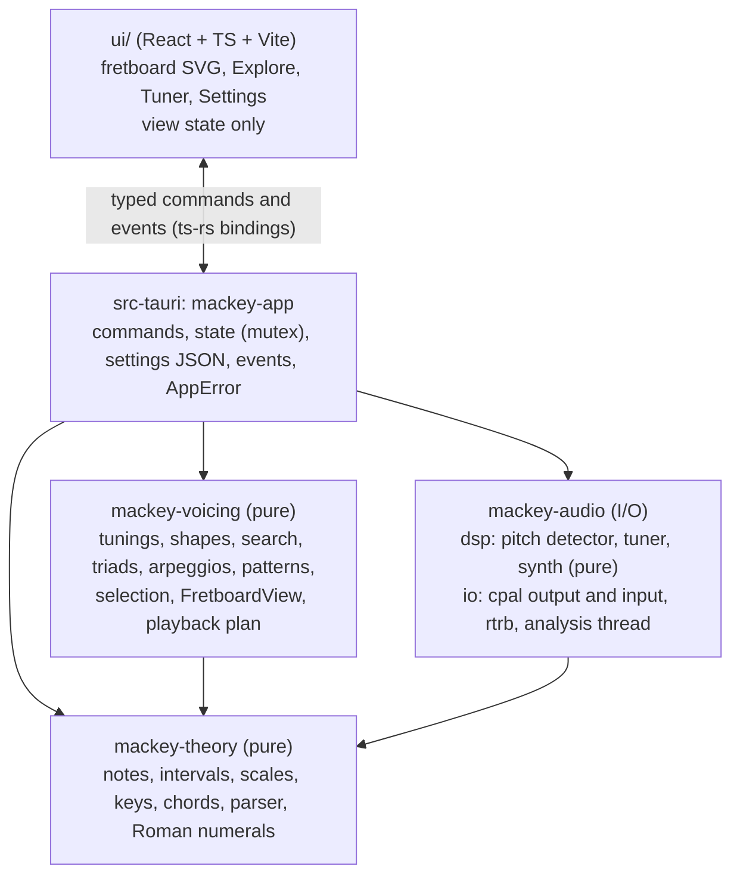
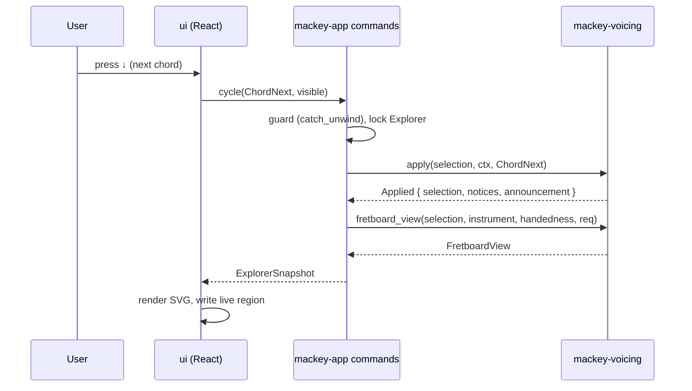
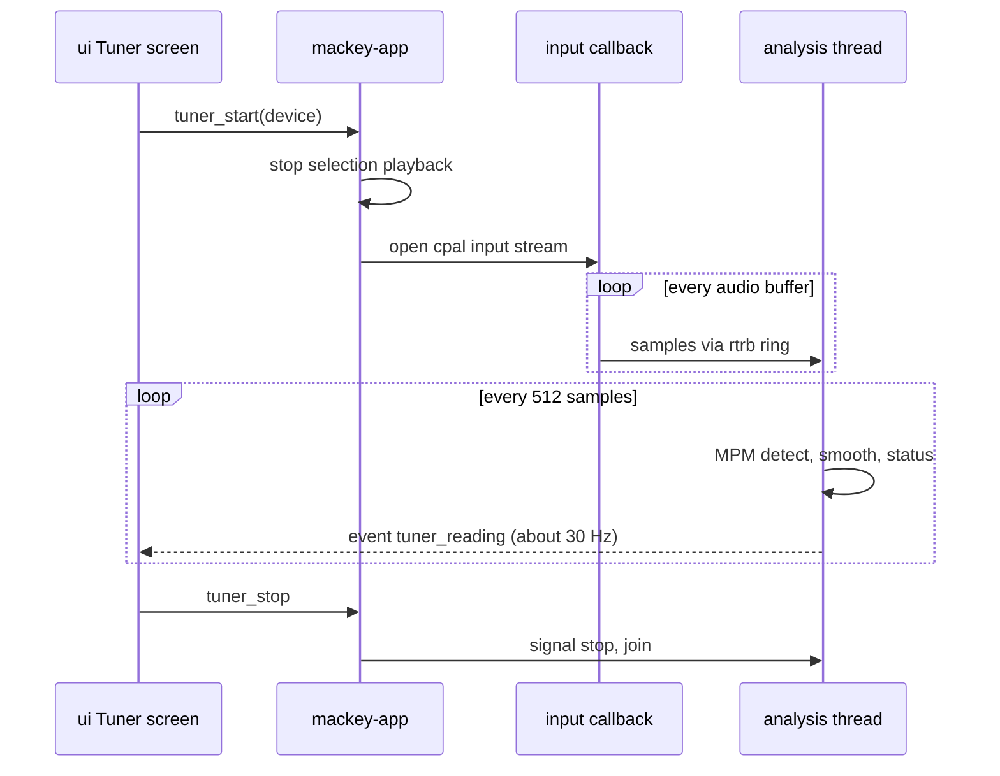

# Architecture: Fretboard Foundation

**Feature:** fretboard-foundation
**Created:** 2026-11-15
**Status:** Draft (reviewed in Step 2)
**Spec:** [spec.md](spec.md) · **Types:** [data-dictionary.md](data-dictionary.md) · **Product architecture:** [docs/architecture.md](../../../docs/architecture.md)

This document narrows [docs/architecture.md](../../../docs/architecture.md) to the crates and folders touched in this run. If they disagree, `docs/architecture.md` is the design authority and the difference is recorded as a decision in [implementation-notes.md](implementation-notes.md).

## Architecture Overview

Pure core, thin shell, view-only UI (AGENTS.md; ADR 0007). Four Rust packages and one web package are added:



Dependency edges in this run (all permitted by the AGENTS.md table; none added):

| From | To | Why |
|------|----|-----|
| `mackey-voicing` | `mackey-theory` | notes, chords, keys, scales |
| `mackey-audio` | `mackey-theory` | `Pitch`, `Note`, `ReferencePitch` for the tuner and synth |
| `mackey-app` | `mackey-theory`, `mackey-voicing`, `mackey-audio` | commands call core functions |

`mackey-audio` does **not** depend on `mackey-voicing` (not allowed by the table). The app converts the instrument (tuning plus capo) into `Vec<TunerTarget>` and a `PlaybackPlan` into `SynthCommand`s (D-08). `mackey-rhythm` arrives in P1b; the `AUDIO` row of `archcheck` already permits it.

I/O ownership: `cpal` only in `mackey-audio`; `tauri`, `tauri-build` only in `mackey-app`; no `rusqlite`, `reqwest`, `ureq`, `hyper` anywhere in this run. `ts-rs` and `serde` are allowed in pure crates (derive only, no I/O at runtime; `ts-rs` writes files only in tests behind the `ts` feature). `proptest`, `insta`, `criterion`, `assert_no_alloc` are dev-dependencies (exempt from archcheck).

## Component Architecture

### `mackey-theory` (pure)

```
crates/mackey-theory/
  Cargo.toml  README.md
  src/
    lib.rs          re-exports, crate docs
    pitch.rs        PitchClass, Letter, Accidental, Note, Pitch, ReferencePitch
    interval.rs     IntervalQuality, Interval
    scale.rs        Mode, Scale
    key.rs          Key, KeySignature, Degree, offered tonics, circle of fifths, relative, enharmonic alt
    spelling.rs     Speller (G-1.5 chromatic spelling, G-1.6 display simplification)
    chord.rs        ChordQuality, Chord, ChordTone, ToneRole, PitchClassSet
    parser.rs       parse_chord_symbol, parse_chord, ParseOptions, ParseOutcome, Diagnostic, ChordParseError, suggestion search
    roman.rs        RomanNumeral, roman_to_chord, diatonic chords
    analysis.rs     ChordAnalysis, ChordFunction, badge text
    error.rs        TheoryError, KeyError
  tests/
    chord_spelling.rs    AC-P0-1 (hand-written expected table)
    chord_parser.rs      AC-P0-2 (table + insta snapshots in tests/snapshots/)
    properties.rs        AC-P0-3 (proptest)
    keys.rs  scales.rs  analysis.rs  roman.rs
    fixtures/            parser inputs (written for the project)
  benches/parser.rs
```

Key algorithms:

- **Interval application.** `Interval::apply(note)`: new letter = `letter.step(number - 1)`; the accidental is whatever makes the semitone distance from the original pitch class equal `interval.semitones()`; if the result needs more than a double accidental it is an error (`TheoryError`), not a wrong note.
- **Chord tones.** `Chord::tones` applies the quality's intervals to the root, so D7 in any key is D F# A C (G-1.5); the key never rewrites chord tones.
- **Speller (G-1.5, G-1.6).** `Speller::new(key, chord, scale)` resolves a pitch class to a `Note` in this order: (1) the chord's tone if the pitch class is a chord tone, (2) the scale's degree if it is a scale tone, (3) the key's preference (sharps for sharp keys, flats for flat keys and C major). `Speller::display(note)` replaces a double accidental with the enharmonic simple name by the same preference and reports the original spelling for the tooltip.
- **Parser.** Hand-written, byte-oriented recursive descent over `&str` (no regex crate, no allocation on the fast path): root, then longest-match quality from a static alias table, then optional `/bass`. Unknown quality text: find a suggestion by (a) replacing `H` with `B` (when `read_h_as_b` is off), then (b) the minimum Damerau-Levenshtein distance over every canonical `root + symbol` and alias, accepted when ≤ 2. The suggestion is a full symbol. The parser never panics on arbitrary UTF-8 (`char_indices`, no slicing off boundaries); this is a proptest.
- **Roman numerals and analysis.** `roman_to_chord` parses degree numerals (case gives quality), optional accidental prefix, suffix (`°`, `ø`, `+`, `7`, `maj7`) and the secondary form `V7/V`. `analyze` first checks diatonic membership (triad or seventh of the key, exact pitch classes and quality), then secondary dominants (a major or dominant-seventh chord whose root is a perfect fifth above a diatonic degree), then borrowed chords (diatonic to the parallel mode: for a major key the parallel natural minor, and vice versa), otherwise `Unknown`.

### `mackey-voicing` (pure)

```
crates/mackey-voicing/
  Cargo.toml  README.md
  src/
    lib.rs
    instrument.rs     StringNumber, Fret, Tuning, TuningPreset, Capo, FretCount, Instrument, Handedness
    shapes/
      mod.rs          curated library lookup (by chord, tuning shift, capo)
      open.rs         the FB-5.3 open shapes as `const` tables
      caged.rs        C, A, G, E, D barre shapes (movable templates)
      drop_d.rs       Drop D entries that differ
    fingering.rs      finger assignment and barre detection
    search.rs         DFS voicing search, scoring, grouping, NoneFound
    triads.rs         string sets, inversions, placements
    arpeggio.rs       window, fingering rule, play order
    patterns.rs       full neck, pentatonic boxes, 3nps, follow-the-chords
    selection.rs      Selection, Action, apply, Notice, announcements
    view.rs           FretboardView builder (positions, labels, a11y, tooltip, off-range, fit range)
    playback.rs       PlaybackPlan
    error.rs
  tests/
    voicings_standard.rs tunings.rs capo.rs no_voicing.rs triads.rs arpeggios.rs
    patterns.rs pattern_stepper.rs view_key_notes.rs view_tooltips.rs selection.rs properties.rs
    fixtures/ snapshots/ (insta: FretboardView JSON for named scenarios)
  benches/{search.rs,view.rs}
```

Key algorithms:

- **Curated first, search second** (architecture §4.1). `voicings_for(chord, instrument, options) -> VoicingResult`:
  1. Compute the *shape chord*: sounding chord minus the capo, minus the tuning's uniform shift for Half-step down and Whole-step down. Look it up in the curated library for the standard shape set; hits become `Origin::Curated` voicings with frets translated by the capo (relative → absolute) (D-04, D-10). Drop D has its own curated entries for D, Dm, D7, Dmaj7, Dsus2, Dsus4 (full six-string versions) and power-chord shapes; every other chord in Drop D is a standard-tuning shape filtered to strings 1 to 5 plus search.
  2. Run the search for every chord regardless (so barre shapes and "Other" fill the list), drop duplicates (same `strings`), mark non-curated tunings `Origin::Search`.
  3. Group (Open / Barre and CAGED / Other), sort by score inside each group, cap at `max_results`.
- **Search.** Fret window `capo..=min(frets, capo + 12)` slid in steps; per string choose `Muted`, `Open`, or a fret in the window whose pitch class is a chord tone. DFS from string 6 to string 1 with pruning: running span ≤ 4 (5 with stretch), fretted count by finger budget (barre counts as one finger), required tones present at the end (root and third, or sus note, or root and fifth for `Power`; fifth optional unless `allow_omitted_fifth` is off *and* the chord needs it for identity, which only applies to `Dim`, `Aug`), lowest sounding string must be the bass note for slash chords and inversions, no muted string between two sounding strings except by explicit skip penalty, pitch-class sets as a `u16` bitmask. Scoring is a weighted sum (span, fingers, open-string bonus when within frets 0 to 4, root-in-bass bonus, skipped-string penalty, hand position near the nut) with weights in one `const` table so the ordering is testable. Identical open strings (E-FB-6) are collapsed in fingering: a barre or fret that falls on two strings tuned the same is one finger.
- **Fingering.** Assign finger numbers by ascending fret across the window, one finger per fretted fret, with barre detection when the lowest fretted fret repeats on two or more strings and no lower fretted note interrupts (the barre spans the outermost strings at that fret, inner strings at higher frets are fingered normally). The result must not exceed 4 fingers (counting a barre once); candidates that would are discarded during search, which is why the same function runs inside the search.
- **Triads.** For a string set and inversion, take the three strings; the bass string must carry the inversion's tone; each other string carries one remaining chord tone; enumerate frets for each string in `capo..=frets` whose pitch class equals the needed tone; keep combinations with span ≤ 4; sort by lowest fret. For seventh chords the triad is the root triad (FB-6.3) and `triad_note` says "Triad of Cmaj7: C E G". If no combination exists, `TriadResult::Unavailable` (FB-6.4).
- **Arpeggio.** Window `start_fret..=start_fret + 3`, plus one fret each side; every chord tone position in `start-1..=start+4` on all six strings (muting strings below the lowest root-or-chord tone is not done: the AC says every A, C and E). Fingers: `fret - start + 1` clamped (start-1 → 1 and start+4 → 4, FB-7.2). Order: ascending pitch (low string upward, lower fret first), reversed for Down, ascending then descending without repeating the top for UpDown. Valid positions are the start frets whose window contains all of the chord's required tones; default per FB-7.4: the start of the selected voicing's window (`lowest_fret`, or 1 less for open voicings) else the lowest valid position containing the root on string 6 or 5.
- **Patterns.** Described in D-21: box k starts on string 6 at degree k of the pentatonic; notes are assigned sequentially in ascending scale order, 2 per string (pentatonic) or 3 per string (7-note); frets come from pitch arithmetic per string, so every tuning works. Full neck = every position whose pitch class is in the scale. Follow-the-chords: `scale_for_chord` per SC-4.
- **Selection and cycling.** `apply` is a pure function `(Selection, Context, Action) -> Applied`. Lists (diatonic chords, voicing list, string sets, inversions, positions, labels) are computed from the context inside `apply` so wrap-around uses the real list length; voicing cycling wraps within the current group, then continues into the next group (FB-9 table). Key change maps the focus to the same scale degree (G-3.3) then re-derives chord and voicing index 0. Tuning or capo change re-runs the search; if the previous voicing's `strings` is not in the new list, index 0 is chosen with `Notice::VoicingChangedForTuning`; if the capo is above the selected position, the position moves to the first at or above the capo with `Notice::MovedAboveCapo` (E-FB-4).
- **`FretboardView`.** Builder walks the six strings and all frets `capo..=fret_count` once; each position is included when the selection says so (voicing: its strings; all tones: every chord-tone pitch class; triad/arpeggio: from their results; key notes: scale pitch classes; overlay: pattern notes as `ScaleTone` unless a chord tone). Roles from `ToneRole`, scale degree labels relative to the overlay scale's tonic when an overlay is on, else the key tonic (SC-5, FB-3.2). Strings in the `[String; 6]` order low to high; the UI flips for presentation. Cost is O(6 × frets) plus the voicing search, cached by the app (below).
- **Playback plan.** Strum notes ordered low to high at 30 ms; arpeggio eighths at 70 bpm in view order; scale ascending from the lowest tonic in the visible range for 8 notes (one octave plus the tonic).

### `mackey-audio`

```
crates/mackey-audio/
  Cargo.toml  README.md
  src/
    lib.rs            AudioError, re-exports
    dsp/                          # pure: no device, no thread, no clock
      mod.rs
      pitch.rs        PitchDetector (McLeod Pitch Method), DetectorConfig, PitchEstimate
      cents.rs        CentsOffset, nearest_pitch, cents_from
      level.rs        LevelMeter, Level
      tuner.rs        Tuner state machine, TunerReading, TunerConfig
      synth.rs        PluckedVoice, Synth, SynthCommand
    io/                           # the only place that touches cpal or spawns threads
      mod.rs
      devices.rs      list_input_devices, default device selection
      output.rs       OutputHandle: cpal output stream + rtrb Producer<SynthCommand>
      input.rs        InputHandle: cpal input stream -> rtrb ring -> analysis thread -> callback
  tests/
    tuner_fixtures.rs   AC-TU-1.1, 1.2, 1.3, 3.1, AC-NF-9 (synthetic signals)
    tuner_strings.rs    AC-TU-2.1, 5.1 and string-mode rules
    synth.rs            no-allocation render, pitch of rendered tones via the detector
  benches/pitch.rs
```

Design points:

- **Pure `dsp` module** compiles and tests without a device. The whole tuner is a function of sample blocks and a sample counter. The `dsp` module is the part measured by the "new pure code fully covered" rule; the `io` module is excluded from coverage by file-name regex with a comment (D-16).
- **MPM** (McLeod Pitch Method): normalised square difference function over lags `0..W/2`, pick the first peak above `k * max_peak` (k = 0.93), parabolic interpolation for sub-sample lag, clarity = peak height. Direct O(W × lags) evaluation is about 1.6 M multiply-adds per 2048 window at 60 Hz, run every 512 samples (about 94 windows per second at 48 kHz) on the analysis thread; if profiling shows trouble, switch the autocorrelation to an FFT (rustfft would be a new dependency, so not preferred, D-06).
- **Tuner state machine** (`dsp::tuner`): per hop, detect, smooth (median of last 3 cents values for the same nearest pitch; reset when the pitch class changes), compute target string (nearest by absolute cents in string mode, or the locked string), decide status. Counters are in samples; `ms = samples * 1000 / sample_rate`. In tune: |cents| ≤ 3 continuously for 300 ms, the hold timer starting at the first in-tune reading. Timing budget for AC-TU-1.1 (in tune within 400 ms of input) and AC-NF-9: the first reading is emitted as soon as 2,048 samples (42.7 ms at 48 kHz) are available, then one per 512-sample hop (10.7 ms); 42.7 + 300 ≈ 343 ms leaves about 57 ms of margin, so the hold must be measured from the first in-tune reading's sample counter, not from a later smoothed value (the median-of-3 uses the readings available so far rather than waiting for three). No stable pitch for 500 ms emits `NoStablePitch`. Level below −50 dBFS for 3 s emits `TooQuiet`. Clipping emits `TooLoud`. Confidence below the threshold with a recent pitch = `LowConfidence`. The UI never computes any of this.
- **Synth** (`dsp::synth`): 16 preallocated Karplus-Strong voices, mono, `f32`. `render` pops nothing itself; the glue's callback drains the `rtrb` consumer into `Synth::apply` before calling `render`. No allocation, lock, log or I/O inside either. A debug test wraps both in `assert_no_alloc::assert_no_alloc` (NF-8.1).
- **Output glue** (`io::output`): `OutputHandle::start() -> Result<OutputHandle, AudioError>` picks the default output device, prefers `f32`, 44.1 or 48 kHz, builds a stream whose callback (1) drains the command queue, (2) renders the synth, (3) writes the mono sample to every channel. Missing device → `AudioError::NoOutputDevice` (E-FB-8). `send` pushes onto the producer; a full queue drops the command and increments an atomic counter read by tests (never blocks).
- **Input glue** (`io::input`): the input callback only copies samples into an `rtrb` ring (mono mixdown of the selected channel); a dedicated analysis thread (`std::thread`, named `mackey-tuner`) reads blocks of `hop` samples, calls `Tuner::push_block`, and invokes the app-supplied callback with each `TunerReading`. Device removal (stream error callback) triggers the E-TU-5 fallback: stop, reopen the default device, and attach `TunerNotice::DeviceDisconnectedUsingDefault` to the next reading. `stop()` joins the thread and drops the stream. The thread body runs under `catch_unwind`; a panic ends the tuner with one `TunerNotice::AnalysisStopped` reading instead of taking the app down. `start` while already running stops the previous handle first (idempotent); `stop` without `start` is a no-op. Audio is never written to disk (NF-7.1).
- **Logging.** `tracing` is used in `io` only, never in a callback.

### `mackey-app` (`src-tauri`)

```
src-tauri/
  Cargo.toml  build.rs  tauri.conf.json  Info.plist  README.md
  capabilities/default.json  README.md  # allow-<command> permissions only; no fs, shell, http, opener
  icons/  README.md                   # generated by `tauri icon` from a placeholder PNG; doccheck needs the README
  src/
    main.rs                           # entry (excluded from coverage: runtime glue)
    lib.rs                            # run(): builder, state, plugins (none), command registration
    commands_list.rs                  # x-macro listing every command name once
    commands/
      mod.rs  explorer.rs  audio.rs  tuner.rs  settings.rs
      manifest.rs                     # CommandSpec table used by the bindings generator
    state.rs                          # AppState { explorer: Mutex<Explorer>, audio: Mutex<AudioPorts>, settings: Mutex<Settings> }
    explorer.rs                       # Explorer (selection, instrument, handedness) + snapshot assembly (no music logic)
    ports.rs                          # trait AudioPort { play(plan), play_note, stop, tuner_start/stop/..., devices } + RealAudio + fakes in tests
    settings.rs                       # Settings types, load/save/reset, atomic write
    error.rs                          # AppError, AppErrorKind, From impls
    guard.rs                          # catch_unwind wrapper returning AppError
    logging.rs                        # tracing subscriber to app data dir log file
    bindings.rs                       # #[cfg(test)] export of ts-rs types, commands.ts, fixtures
  tests/                              # integration tests with a fake AudioPort
```

Rules honoured: no music logic in `src-tauri` (the explorer module only calls `mackey-voicing::{apply, fretboard_view, voicings_for, playback_plan}` and builds the panel from core values); the `Mutex`es are never touched by the audio thread (the audio thread talks only through the `rtrb` queue and the analysis callback, which emits the Tauri event through an `AppHandle` clone, not through app state); no `lazy_static`/`OnceLock` global state; `unsafe` forbidden.

**AudioPort trait.** Commands depend on `trait AudioPort`, not on `mackey-audio::io` directly. `RealAudio` implements it with `OutputHandle`/`InputHandle`; tests use `FakeAudio` (`NoDevice`, `Recording`). This is what makes AC-E-FB-8 and the "Play returns 'No audio output' once" behaviour testable without a device.

**Caching.** `Explorer` memoises the last `VoicingResult` keyed by `(chord, instrument, options)` so a cycling action does not repeat the search (benchmarked target: view ≤ 2 ms including cache hit). The cache is an ordinary field behind the explorer mutex, not a global.

**Logging.** `tracing-subscriber` with a non-blocking `tracing-appender` file layer in `app_data_dir/logs/`, daily rotation keeping 3 files; commands log errors with their full source chain through `guard`.

#### Tauri commands

All return `Result<T, AppError>`; arguments and results are ts-rs types. `ExplorerSnapshot` = `{ view, panel }`. Argument `visible` is the UI's visible fret range (for off-range counts and the scale playback).

| Command | Arguments | Returns | Notes |
|---------|-----------|---------|-------|
| `get_snapshot` | `visible?` | `ExplorerSnapshot` | Current state; used at start-up (AC-P0-5). |
| `fretboard_view` | `visible?` | `FretboardView` | Walking-skeleton command; same as `get_snapshot().view`. |
| `select_key` | `tonic: Note, mode: Mode, visible?` | snapshot | Normalises per G-1.4; keeps degree (G-3.3). |
| `select_diatonic_chord` | `degree: Degree, visible?` | snapshot | Chord strip. |
| `select_chord` | `text: String, visible?` | snapshot | Chord symbol or Roman numeral; error leaves the selection unchanged and the panel carries `ChordFieldStatus::Error`. |
| `parse_chord` | `text: String` | `ParseOutcome` | Live validation without selecting (FB-4.4). |
| `select_note` | `string, fret, visible?` | snapshot | Click on a position when no chord context (focus Note). |
| `select_tuning` | `tuning: TuningChoice, visible?` | snapshot | Applies G-3.4. |
| `set_capo` | `capo: Capo, visible?` | snapshot | E-FB-4. |
| `set_view_type` | `view: ViewType, visible?` | snapshot | |
| `set_labels_mode` | `labels: LabelsMode, visible?` | snapshot | |
| `set_scale_overlay` | `on: bool, scale: Option<Scale>, follow: bool, visible?` | snapshot | |
| `set_option` | `option: ExplorerOption, visible?` | snapshot | `ExplorerOption` = `ShowSevenths(bool)`, `ShowAllOnSet(bool)`, `ShowOrder(bool)`, `ArpeggioDirection(..)`, `AllowStretch(bool)`, `AllowOmittedFifth(bool)`, `CapoNames(..)`. |
| `cycle` | `action: CycleAction, visible?` | snapshot | All FB-9 cycling actions, key next/prev, relative toggle. |
| `voicings_for` | `chord_text: String, options?` | `VoicingResult` | Stateless helper for the voicing list on arbitrary chords. |
| `fit_selection` | `margin: u8 = 1` | `FretRange` | FB-1.5 (also in `view.fit_range`). |
| `play_selection` | `visible?` | `()` | Builds the `PlaybackPlan`; on no device returns `AppErrorKind::NoAudioOutput`; the UI shows the notice once. |
| `play_note` | `string: StringNumber, fret: Fret` | `()` | FB-1.7. |
| `stop_playback` | none | `()` | |
| `list_input_devices` | none | `Vec<InputDevice>` | TU-6. |
| `tuner_start` | `device: Option<String>` | `TunerStartInfo { permission: MicPermission, targets: Vec<TunerTarget>, device: InputDevice }` | Stops selection playback first (TU-7); starts the analysis thread; emits `tuner_reading`. |
| `tuner_stop` | none | `()` | Joins the analysis thread; restores nothing else (no audio session in this run). |
| `tuner_set_mode` | `mode: TunerMode` | `()` | Chromatic or string mode with tap-to-lock. |
| `tuner_reference_tone` | `string: u8, on: bool` | `()` | TU-4; plays from the synth (works without mic permission, E-TU-2). |
| `open_system_settings` | `pane: SettingsPane` | `()` | macOS: `open x-apple.systempreferences:...Privacy_Microphone` via `std::process::Command` (only in `src-tauri`); iPad: returns `AppErrorKind::Invalid` with the text "Open Settings > Mackey > Microphone" until the Swift plugin exists. |
| `get_settings` | none | `Settings` | |
| `set_settings` | `patch: SettingsPatch` | `Settings` | Applies immediately; instrument settings update the explorer state and return a fresh snapshot through the next explorer call. |
| `reset_settings` | `group: SettingsGroup` | `Settings` | AC-FR-028. |

`open_system_settings` and the tuner commands are the only commands with platform-specific bodies (`#[cfg(target_os)]`), as AGENTS.md allows in `src-tauri`.

Capabilities (`capabilities/default.json`): window `main`, permissions only `allow-<command>` for the commands above (generated from `tauri-build`'s `AppManifest`, fed by `commands_list.rs`) plus `core:event:default` for listening. No `fs`, `shell`, `http`, `opener` or `dialog` permissions.

#### Events

| Event | Payload | Rate | Producer |
|-------|---------|------|----------|
| `tuner_reading` | `TunerReading` | about 30 Hz (the analysis thread rate-limits emission to the latest reading every 33 ms; hop rate is about 94 Hz) | analysis thread callback via `AppHandle::emit` |

No other events in this run (`transport_position` is P1b).

#### Bindings generation (D-05)

- Each core and app type derives `ts_rs::TS` under `#[cfg_attr(feature = "ts", ...)]` with `#[ts(export, export_to = "...")]`. `ts-rs` writes one `.ts` file per type at `cargo test` time to `TS_RS_EXPORT_DIR`.
- ts-rs does not generate command wrappers. `src-tauri/src/commands/manifest.rs` holds the `CommandSpec` table (`name`, argument names with their Rust types, return type); the generator in `src-tauri/src/bindings.rs` (a `#[test]` gated on `ts`) writes `ui/src/bindings/commands.ts` with one typed `async` function per command calling `invoke` from `@tauri-apps/api/core`, converting `AppError` rejections into thrown `AppError` values, plus `events.ts` for `tuner_reading`.
- `commands_list.rs` is an x-macro (`macro_rules! for_each_command { ($m:ident) => { $m!{ get_snapshot, select_key, ... } } }`), used (1) to build `tauri::generate_handler!`, (2) to produce `COMMAND_NAMES: &[&str]`, and (3) `include!`d by `build.rs` to build the `AppManifest`. A test asserts `COMMAND_NAMES` equals the manifest table's names, so a command cannot be added in one place only.
- The same test run writes `ui/src/mocks/scenarios.json` by driving the real `Explorer` through scripted action sequences (D-14).
- `make bindings` runs the export tests with `--features ts` and `TS_RS_EXPORT_DIR=ui/src/bindings`, then runs `prettier --write` on the output for stable formatting. `make bindings-check` runs it and `git diff --exit-code ui/src/bindings ui/src/mocks` (stale bindings fail CI).

### `ui/` (React + TypeScript + Vite)

```
ui/
  package.json  package-lock.json  tsconfig.json  vite.config.ts  eslint.config.js  .prettierrc
  index.html  playwright.config.ts  README.md  .nvmrc
  src/
    main.tsx  App.tsx
    bindings/              GENERATED (ts-rs + commands.ts); never edited; README.md says so
    commands/index.ts      picks real or mock commands
    mocks/                 mockCommands.ts, scenarios.json (generated), mockTuner.ts
    state/store.ts         Zustand store (view state only)
    layout/                useLayout.ts, Sidebar.tsx, AppShell.tsx
    fretboard/
      Fretboard.tsx  Neck.tsx  FretLines.tsx  StringLines.tsx  Inlays.tsx
      NoteMarker.tsx       shape by role: root = rounded square, chord tone = filled circle, scale tone = ring, single note = diamond
      Tooltip.tsx  EdgeArrows.tsx  RangeControls.tsx  Barres.tsx  FretNumbers.tsx  CapoBar.tsx
      geometry.ts          12th-root-of-2 spacing, min widths, mirroring and flip transforms (pure functions, Vitest)
    explore/
      ExploreScreen.tsx  Toolbar.tsx  KeyPicker.tsx  TuningCapoPicker.tsx  LabelsPicker.tsx  ViewTypePicker.tsx
      ChordStrip.tsx  ChordField.tsx  VoicingList.tsx  MiniDiagram.tsx
      TriadControls.tsx  ArpeggioControls.tsx  ScaleControls.tsx  NotInKeyBadge.tsx  PlayButton.tsx
    tuner/
      TunerScreen.tsx  MicExplainer.tsx  MicDenied.tsx  Needle.tsx  StringTargets.tsx  DevicePicker.tsx  LevelMeter.tsx  ReferenceTone.tsx
    settings/SettingsScreen.tsx
    a11y/LiveRegion.tsx  announce.ts
    shortcuts.ts  useShortcuts.ts  gestures.ts (swipe detection for iPad)
    theme/tokens.css       Okabe-Ito tokens, light and dark, focus ring
  tests/                    Vitest unit tests next to what they test (`*.test.ts(x)` under src/)
  e2e/  README.md           Playwright specs (WebKit): neck, cycling-perf, live-region, tooltip, left-handed, tuner, ipad-layouts, narrow, shortcuts, a11y (the README is needed because doccheck does not skip `e2e`)
```

Rules: the UI never computes music theory. `geometry.ts` is layout maths (pixels), not theory. Shapes by role and colour tokens come from G-2; the `NoteMarker` reads `role` and `labels` from `ViewPosition` and picks a label by `labels_mode`. The Explore screen is a thin renderer of `ExplorerPanel`. The tuner screen renders `TunerReading` only.

## Layer Responsibilities

| Layer | Owns | Must not |
|-------|------|----------|
| `mackey-theory` | Spelling, chords, keys, parsing | I/O, threads, global state; know about frets |
| `mackey-voicing` | Frets, voicings, patterns, selection, `FretboardView`, playback plan | I/O, threads, global state; open devices |
| `mackey-audio::dsp` | Pitch, tuner state, synth maths | allocate or lock in `render`; read the clock |
| `mackey-audio::io` | cpal streams, threads, ring buffers | contain music rules |
| `mackey-app` | Commands, state mutex, settings file, error mapping, events | contain music logic; be touched by the audio callback |
| `ui` | Drawing, layout, input handling, announcements | recompute theory; hand-edit bindings |

## Data Flow

**Cycling action (Mac).**

1. `keydown` (not in a text field) → `useShortcuts` maps the key to a `CycleAction` (table in `shortcuts.ts`).
2. `commands.cycle(action, visible)` → `mackey-app::commands::explorer::cycle` → `guard` → lock explorer → `mackey_voicing::apply` → `Applied` → `fretboard_view` → build `ExplorerPanel` → return `ExplorerSnapshot`.
3. The store replaces `snapshot` only if `snapshot.revision` is higher than the stored one (two quick key presses can resolve out of order; the UI also serialises commands through one promise queue so Rust sees them in key order, SAC-18);  `Fretboard` re-renders from `snapshot.view`; `LiveRegion` writes `view.announcement`; the notice banner shows `view.notices`.

**Play.** Space → `play_selection(visible)` → explorer builds a `PlaybackPlan` → `AudioPort::play(plan)` converts each note to `SynthCommand::NoteOn { frequency, velocity, delay_samples }` (using the output sample rate) → `rtrb` producer → output callback drains and renders → device. Absent device: `RealAudio` returns `NoOutputDevice` → `AppError { kind: NoAudioOutput }` → the UI shows "No audio output" the first time only (`audioNoticeShown`) and keeps working.

**Tuner.** `Cmd-T` → UI navigates to Tuner; if `!settings.tuner.mic_explained` it shows the explainer first; Continue calls `tuner_start`; the app stops selection playback, opens the input stream (the OS prompt appears here, NF-7.2), starts the analysis thread; each hop the `Tuner` emits a reading; the callback emits `tuner_reading` at about 30 Hz; the UI renders the latest. Leaving the screen, hiding the page (`visibilitychange` to hidden, which is what iPad backgrounding does; platforms.md §3 allows no background audio) or closing the window (`RunEvent::ExitRequested` in the app) calls `tuner_stop`.

**Settings.** `set_settings(patch)` → validate and clamp → write atomically → update `Explorer` (instrument, handedness, default labels) → return `Settings`; the UI re-requests a snapshot. Theme is applied in the UI by setting `data-theme` on `<html>` (the only settings the UI interprets itself, plus fret-number visibility, which is a rendering toggle).

## Sequence Diagrams





## Integration Points

- **Tauri 2:** `tauri.conf.json` (`app.windows`: `minWidth` 900, `minHeight` 600, `width` 1280, `height` 800; `build.frontendDist` `../ui/dist`; `devUrl` `http://localhost:1420`; `app.security.csp`: `default-src 'self'; script-src 'self'; style-src 'self' 'unsafe-inline'; img-src 'self' data:; connect-src ipc: http://ipc.localhost; object-src 'none'` — `'unsafe-inline'` for styles only because React sets inline `style` attributes for SVG geometry; revisit with CSS variables if possible). `bundle.macOS.minimumSystemVersion` `13.0`; `bundle.iOS.minimumSystemVersion` `17.0`; `Info.plist` with `NSMicrophoneUsageDescription` ("Mackey uses the microphone only to hear your guitar for the tuner. Nothing is recorded or sent anywhere."). `tauri ios init` generates `src-tauri/gen/apple` in CI (not committed, `.gitignore` already excludes build output; the generated project directory is listed under `gen` in doccheck's skip list).
- **cpal:** CoreAudio on macOS and iOS; ALSA on Linux CI (compile and no-device paths only).
- **Node and npm:** Node 22 LTS, `npm ci`. Tauri CLI from `@tauri-apps/cli` (invoked as `npx tauri` by the Makefile).
- **GitHub Actions:** `actions/checkout`, `Swatinem/rust-cache`, `taiki-e/install-action`, `actions/setup-node`, Playwright's `--with-deps webkit`.

### CI jobs (`.github/workflows/ci.yml`)

| Job | Runner | Steps |
|-----|--------|-------|
| `rust (macos-latest)`, `rust (ubuntu-latest)` | matrix | existing steps; Linux first runs `apt-get install` of `libwebkit2gtk-4.1-dev libgtk-3-dev libsoup-3.0-dev libjavascriptcoregtk-4.1-dev librsvg2-dev libasound2-dev libssl-dev pkg-config` (and `patchelf` is not needed); `make build`/`test`/`lint`/`cover` create the `ui/dist` stub when absent |
| `ui` | ubuntu-latest | `actions/setup-node` (cache npm), `make ui-lint`, `make ui-test` |
| `e2e` | ubuntu-latest | setup-node, `npx playwright install --with-deps webkit`, `make e2e` (desktop 1280×800 and iPad 1180×820 projects; uploads trace artefacts on failure) |
| `bindings` | ubuntu-latest | Rust toolchain, system packages, setup-node, `make bindings-check` |
| `mac-app` | macos-latest | Rust, setup-node, `make app` (universal, unsigned, `--no-bundle` first; `.app` zip uploaded as an artefact) |
| `ios-sim` | macos-latest | Rust with iOS targets (from `rust-toolchain.toml`), setup-node, `make ios-sim` (runs `tauri ios init` then the build, with the fallback chain recorded in task E6) |

All of the above are required checks (branch protection is configured by `/repo:add-branch-restricts`, which is outside this run; the job names are stable so J can mark them required). Workflow-wide `RUSTFLAGS: -D warnings` stays.

## Architectural Decisions

Recorded in [implementation-notes.md](implementation-notes.md#technical-decisions) as D-01..D-27. The decisions that would warrant a repository ADR if they stand after implementation:

- ts-rs over tauri-specta with a generated command-wrapper layer (add the one-line note to ADR 0007; a new ADR only if the generator grows beyond the manifest approach).
- Rust-owned selection state in `src-tauri` (consistent with ADR 0007; no ADR needed).
- Unsigned iOS Simulator build recipe (new ADR note in ADR 0008 once task E6 finds the working command).
- Any `deny.toml` licence addition needed by Tauri's transitive dependencies (ADR note with the crate and licence).
