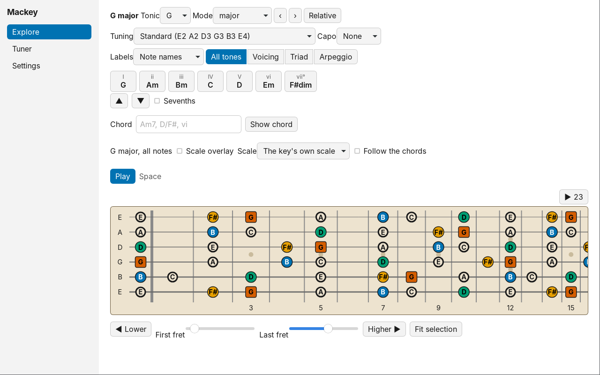
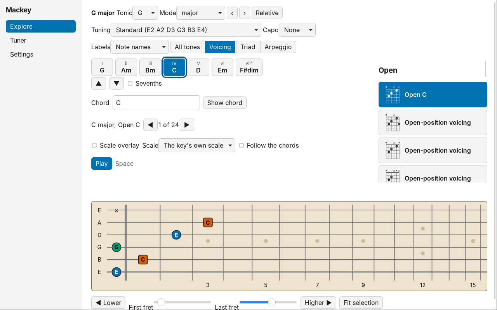
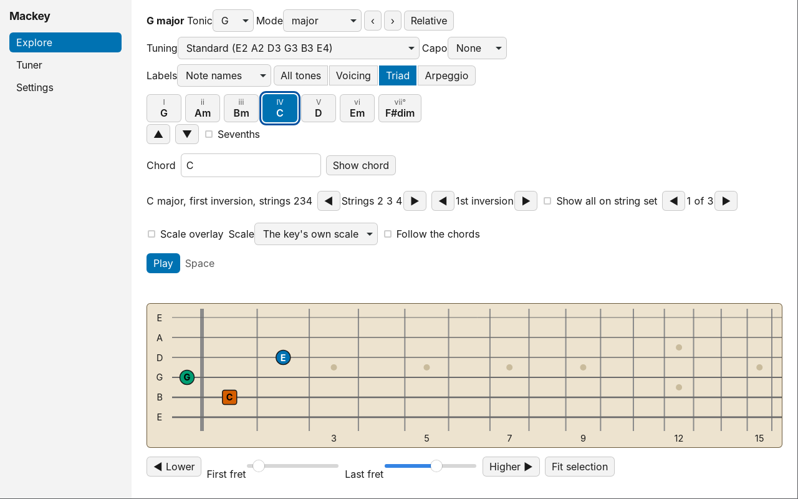
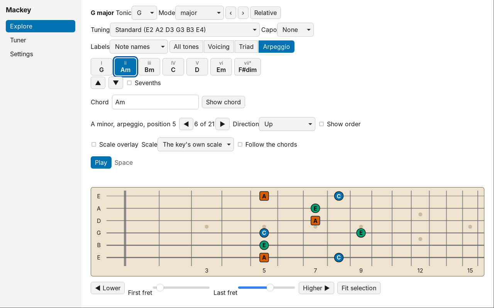
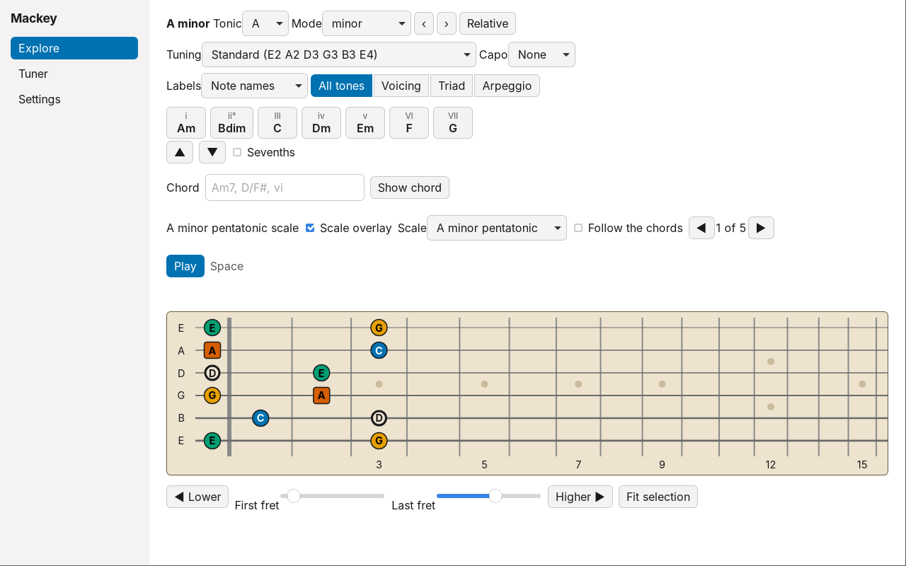
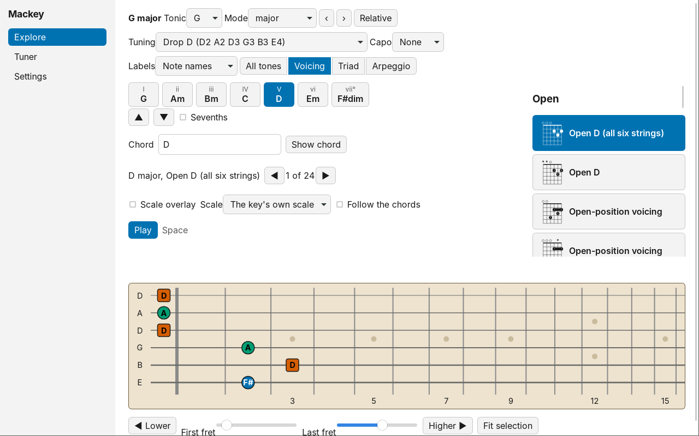
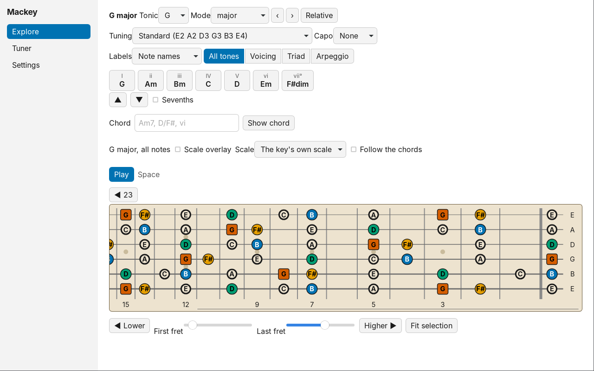

# Explore

Explore is the main screen: a key picker, a row of chords, controls for how a chord is shown, and the neck. This guide covers each part.

## Keys and notes

Choose a **Tonic** and a **Mode** (major, natural and harmonic minor, the church modes from Dorian to Locrian, the two pentatonic scales and the blues scale). The `‹` and `›` buttons move one step round the circle of fifths. **Relative** jumps to the relative major or minor.

The neck marks every note of the key. Each note has a shape as well as a colour, so you never need the colour to read it:

| Shape | Meaning |
|---|---|
| Square | The root |
| Filled circle | A chord tone (third, fifth, seventh) |
| Ring | Another note of the key or scale |

Hover a note (tap on iPad) for its name and role; click or tap it to hear it. Labels show note names by default; the **Labels** menu changes them to scale degrees, intervals, finger numbers or nothing.

Notes are spelled the way the key spells them: in F you see B-flat, not A-sharp.

### Notes beyond the visible frets

The neck shows about 15 frets at a time on a 1280-pixel window. When highlighted notes lie beyond the view, a button above the neck at that edge gives the count, for example `▶ 23`. Choose it to fit the selection. **Lower**, **Higher** and the two fret sliders move and size the view by hand. A neck has 19 to 24 frets (22 by default; see [Settings](settings.md)).

## Chords

- **The chord row** lists the chords of the key with Roman numerals. Tick **Sevenths** for seventh chords. The `▲` `▼` buttons, or the up and down arrow keys, step through them.
- **The Chord field** takes any chord symbol (`Am7`, `Cmaj7`, `Bb`, `D/F#`, `Gsus4`) or a Roman numeral (`vi`, which means Em in G). If the app does not understand it, it says so under the field and often suggests the correct spelling. Your text stays in the field so you can fix it.

## Ways to show a chord

The four buttons next to **Labels** choose the view:

| View | Shows |
|---|---|
| All tones | Every note of the key (or the chord, once you pick one) |
| Voicing | One way to play the chord, plus a list of the others |
| Triad | The three-note chord on three adjacent strings, in an inversion |
| Arpeggio | The chord tones as a pattern along the neck |

### Voicings

The voicing list is grouped (Open, Barre, Position) and sorted best first. Open shapes and the movable CAGED shapes are the ones a teacher would draw; the search fills the gaps. Step through with the arrows next to the name, the left and right arrow keys, or click an entry. Above the nut, `x` means the string is not played and `○` means it rings open. The lowest sounding note is always the chord's root, or the bass of a slash chord.

If nothing fits, the app says why and offers to relax a rule: **Allow stretch** (a five-fret span) or **Allow omitted fifth**.

### Triads

Choose **Triad** and pick a string set (strings 1 to 3, 2 to 4, 3 to 5 or 4 to 6) and an inversion (root position, first, second). The example shows C major in first inversion on strings 2, 3 and 4: E on the D string, G on the G string, C on the B string. **Show all on string set** displays every placement along the neck. For a seventh chord the app shows the triad of its root, for example "Triad of Cmaj7: C E G".

### Arpeggios

Choose **Arpeggio** to see the chord tones laid out in one position, which the app numbers and names (here position 5, entry 6 of 21 in the stepper, counting the open position as 0). **Direction** sets playback to Up, Down or Up and down; **Show order** numbers the notes.

### Playing it

**Play** (or Space) plays what you see: a chord is strummed, an arpeggio is played note by note. Escape stops it. If the computer has no audio output the app says "No audio output" once and carries on.

## Scales

Tick **Scale overlay** and pick a scale from the **Scale** menu. The overlay is drawn under the chord, so you can see how a chord sits in its scale. With a pentatonic scale the stepper beside it moves between the five boxes.

The example is A minor with the A minor pentatonic overlay on, showing the first of its five boxes (frets 0 to 3, the lowest). The notes are A, C, D, E and G on every string. **Follow the chords** switches the overlay to the scale that matches the current chord, which is the minor pentatonic for a minor chord.

## Tunings and capo

**Tuning** offers nine presets (Standard, Drop D, Double drop D, DADGAD, Open G, Open D, Open E, Half step down, Whole step down) and **Custom...**, where you give six pitches such as `D2`, `A2`, `D3`, `G3`, `B3`, `E4`. Every voicing, triad and pattern is recalculated for the tuning. The example is Drop D: the chord is the open D (`000232`) because the low string is now a D.

**Capo** puts a capo on any fret from 1 to 12. The nut moves to the capo and the shapes shift with it.

## Left-handed

Turn on **Left-handed** in [Settings](settings.md) and the neck mirrors, with the nut on the right and the fret numbers rising towards the left. **Flip strings** puts the sixth string at the top, as in a tab, if you prefer that view.

## Keyboard shortcuts

Single-key shortcuts are ignored while the focus is in a text field, so typing a chord never triggers them. `Cmd` is `Ctrl` on a keyboard that has no Command key.

| Key | Action |
|---|---|
| `↓` / `↑` | Next / previous chord in the key |
| `→` / `←` | Next / previous voicing (or position, in arpeggio view) |
| `I` / `Shift-I` | Next / previous inversion |
| `S` / `Shift-S` | Next / previous string set |
| `P` / `Shift-P` | Next / previous position |
| `V` | Cycle the view: all tones, voicing, triad, arpeggio |
| `L` | Cycle the labels |
| `O` | Toggle the scale overlay |
| `]` / `[` | Next / previous key round the circle of fifths |
| `R` | Relative major or minor |
| `Space` | Play |
| `Esc` | Stop |
| `Cmd-T` | Open the Tuner |
| `Cmd-,` | Open Settings |
| `Cmd-0` | Show or hide the sidebar |

Each change is announced to screen readers (VoiceOver) in a live region, and every control has a label.

## On iPad

Swipe the neck sideways to move along it, pinch to change how many frets are shown, and swipe up or down on the chord row to change chord. Every control that works on hover also works on tap.

Back to [user-docs](README.md).
