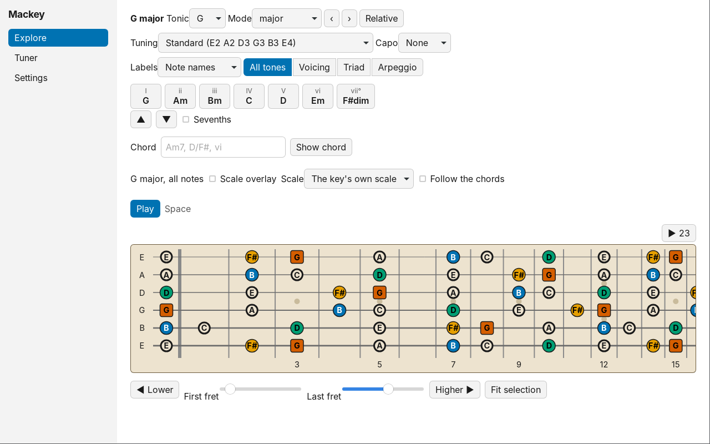
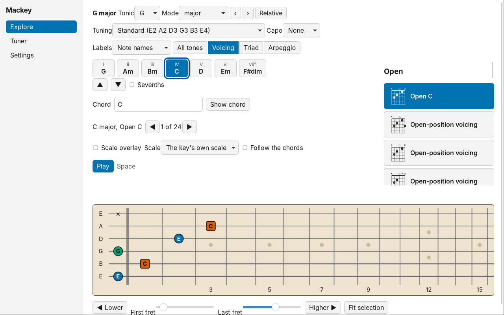
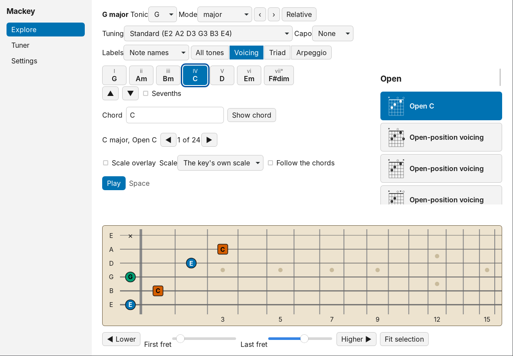

# Getting started

Mackey Guitar Tutor shows you the guitar neck. Pick a key and the neck lights up every note of it; pick a chord and it shows how to play it. Today the app has three screens: [Explore](explorer.md), the [Tuner](tuner.md) and [Settings](settings.md). Practice sessions and songs are not built yet.



*Explore on first launch: every note of G major. Square = root, filled circle = chord tone, ring = other note of the key.*

## Install from source on a Mac

There is no download yet; you build the app yourself. You need a Mac running macOS 13 or later.

1. Install the Xcode command line tools: `xcode-select --install`.
2. Install Rust from [rustup.rs](https://rustup.rs). The right toolchain version is picked up from `rust-toolchain.toml` the first time you build.
3. Install Node 22 (for example with Homebrew: `brew install node@22`).
4. Get the code and install the UI dependencies:

   ```sh
   git clone https://github.com/stainedhead/mackey-guitar-tutor.git
   cd mackey-guitar-tutor
   npm ci --prefix ui
   ```

5. Build the app: `make app`. This produces a universal (Apple silicon and Intel) app, ad-hoc signed, under `target/universal-apple-darwin/release/bundle/` (the `.app` is in `macos/`, the `.dmg` in `dmg/`).

To try the app without installing it, run `npm run tauri dev` from the repository root instead. It opens the app with hot reload.

### First launch

The app is signed ad hoc, not with an Apple Developer ID, so macOS blocks it the first time. Open **System Settings > Privacy & Security**, scroll to the message about "Mackey Guitar Tutor" and choose **Open Anyway**. Details are in [troubleshooting](troubleshooting.md#macos-says-the-app-cannot-be-opened).

The first time you open the Tuner, macOS asks for microphone access. The app only listens while the Tuner is open and never records or sends audio anywhere.

## A five-minute tour

1. **See a key.** Explore opens in G major. Use the Tonic and Mode menus, or the `‹` `›` buttons to walk round the circle of fifths.
2. **Pick a chord.** Click a chord in the row (I, ii, iii ...), or type one such as `Am7` or `D/F#` into the Chord field and press Enter.
3. **See how to play it.** Choose **Voicing** in the view buttons. The voicing list on the right shows every shape found, with a small diagram. Press the right arrow key to step through them.
4. **Hear it.** Press Space, or click any note on the neck.
5. **Tune up.** Open the **Tuner** in the sidebar, choose Continue and play a string.



*The open C chord. `x` over a string means do not play it; a circle means play it open.*

## On iPad

The same screens with larger touch targets: swipe the neck to move along it, pinch to zoom the fret range, swipe up or down on the chord row to change chord. In portrait the sidebar becomes a tab bar. The iPad build runs in the iOS Simulator today (`make ios-sim`, macOS with Xcode); installing on a real iPad has not been validated yet ([roadmap](../docs/roadmap.md#ipad-device-validation-short-step-when-j-sets-up-a-free-apple-id)).



*Explore at the iPad landscape window size. This is the desktop app in a window of that size, not the iPad app.*

Next: [Explore](explorer.md). Back to [user-docs](README.md).
