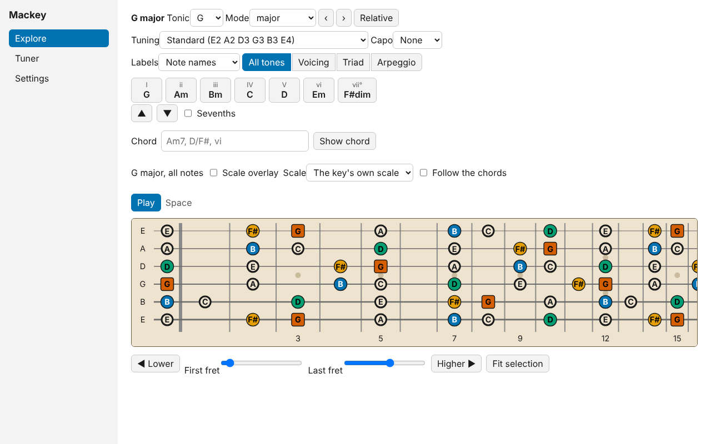
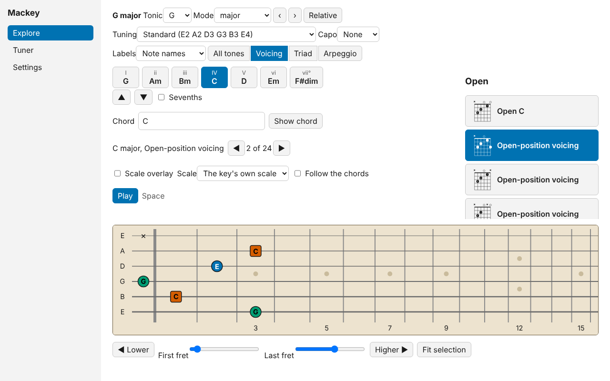
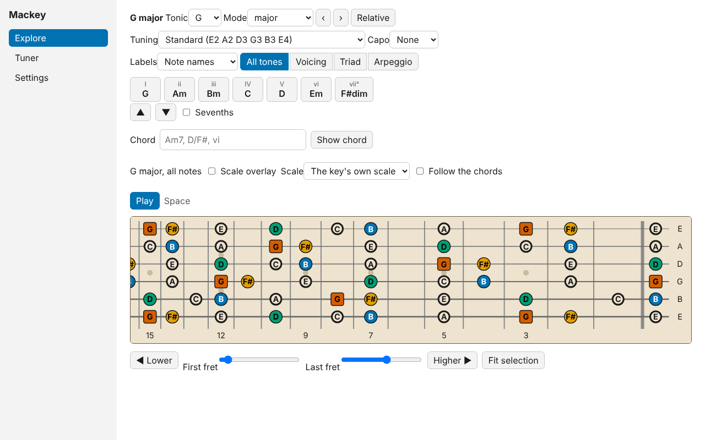
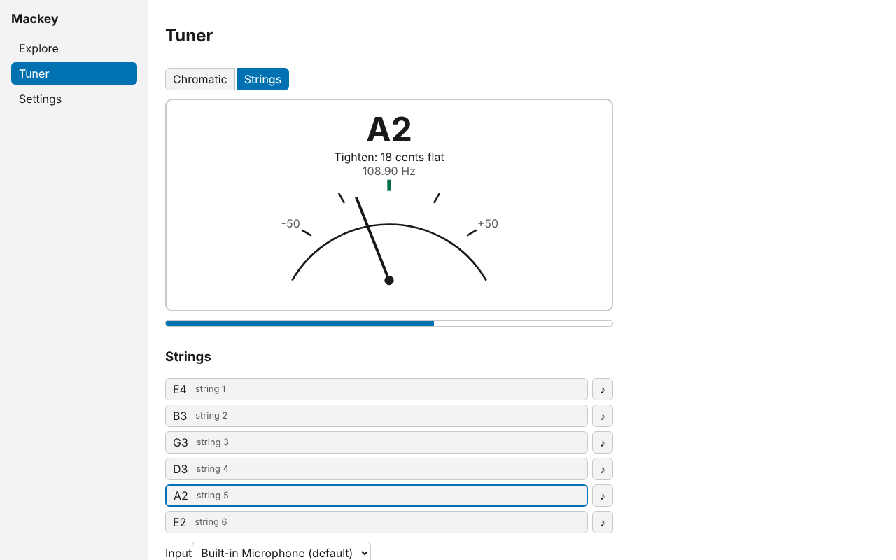
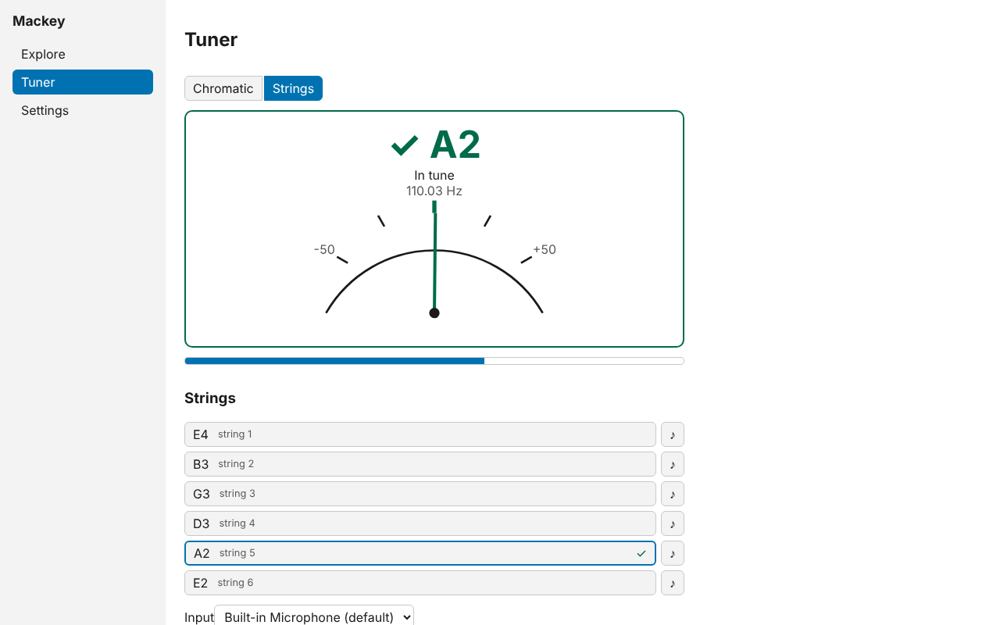
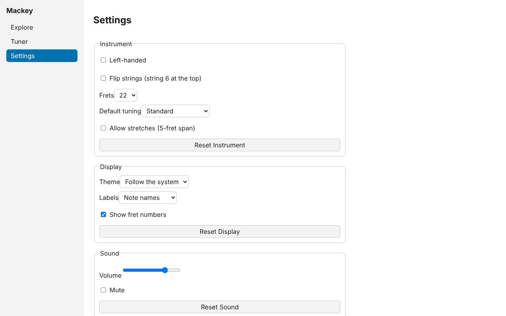
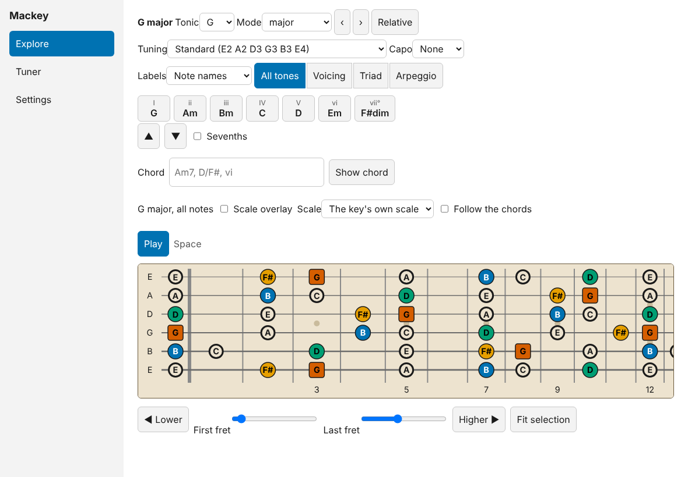

# Getting started

Mackey Guitar Tutor shows you the guitar neck. Pick a key and the neck lights up every note of it; pick a chord and it shows how to play it. This guide covers what the app does today: **Explore**, the **Tuner** and **Settings**.

## Explore

The neck shows G major. Each note has a shape as well as a colour, so you never need the colour to read it: a **square** is the root, a **filled circle** is a chord tone (third, fifth, seventh) and a **ring** is another note of the key. Hover a note (or tap it on iPad) to see its name and role, and click it to hear it.

- **Key:** choose a tonic and a mode at the top, or step round the circle of fifths with the arrows. "Relative" jumps to the relative major or minor.
- **Chords in the key:** the row of buttons lists the chords that belong to the key, with Roman numerals. Tick "Sevenths" to see seventh chords. The up and down arrows (or the arrow keys) step through them.
- **Chord field:** type any chord, such as `Am7`, `D/F#` or a Roman numeral like `vi`. If the app does not understand it, it says so under the field and often suggests the right spelling.

- **Voicing view:** shows one way to play the chord and lists the others, with a small diagram for each. Use the arrows beside the name, or Right and Left, to step through them. An `x` above a string means do not play it.
- **Tuning and capo:** the neck and the chord shapes follow your tuning and capo.
- **Play:** the Play button (or Space) strums the chord you see.

### Left-handed

Turn on "Left-handed" in Settings and the neck mirrors, with the nut on the right.

## Tuner

The first time you open the Tuner it explains that the microphone is used only to hear your guitar, and nothing is recorded or sent anywhere. Then play a string: the big letter is the note, the words say how many cents flat or sharp you are, and the needle shows the same. In "Strings" mode the app compares what you play with the string you are tuning, and ticks each string when it is in tune. The note button beside a string plays a reference tone.

## Settings

Left-handed, tuning, number of frets, note labels, theme (system, light or dark), volume and the tuner's input device. Each group has its own "Reset" button.

## On iPad

The same screens, with larger touch targets. Swipe left or right on the neck to move along it, pinch to zoom the fret range, and swipe up or down on the chord row to change chord. In portrait the sidebar becomes a tab bar.

## Keyboard

Arrow keys step through chords and voicings; Space plays; the shortcuts are ignored while you type in a text field. Back to [user-docs](README.md).
