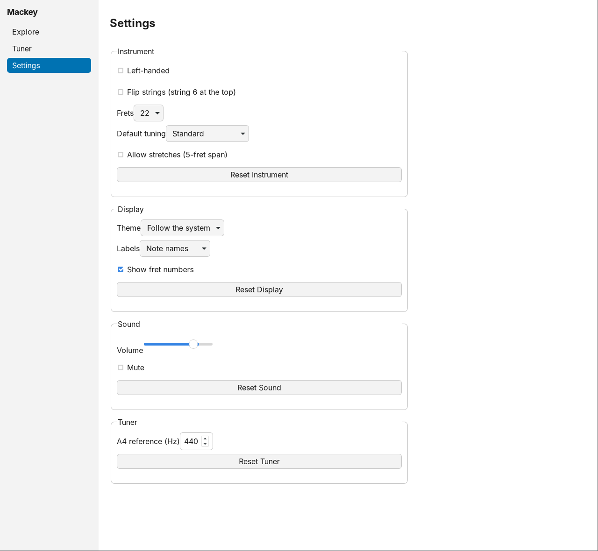

# Settings

Open Settings from the sidebar or with `Cmd-,`. Changes apply at once and are saved. Each group has its own **Reset** button, which returns that group to its defaults.

## Instrument

| Setting | Default | What it does |
|---|---|---|
| Left-handed | Off | Mirrors the neck: nut on the right ([Explore](explorer.md#left-handed)) |
| Flip strings (string 6 at the top) | Off | Draws the sixth string at the top, as in a tab |
| Frets | 22 | The number of frets on the neck, from 19 to 24 |
| Default tuning | Standard | The tuning Explore starts in. One of nine presets; a custom tuning is chosen in Explore |
| Allow stretches (5-fret span) | Off | Lets voicing search use shapes that span five frets instead of four |

## Display

| Setting | Default | What it does |
|---|---|---|
| Theme | Follow the system | Light, dark, or follow the system. Every colour cue also has a shape, in both themes |
| Labels | Note names | What Explore shows on the notes to begin with: note names, scale degrees, intervals, finger numbers or none |
| Show fret numbers | On | Numbers under the neck |

## Sound

| Setting | Default | What it does |
|---|---|---|
| Volume | 80 | Output level for chords, notes and reference tones, 0 to 100 |
| Mute | Off | Silences everything the app plays |

## Tuner

| Setting | Default | What it does |
|---|---|---|
| A4 reference (Hz) | 440 | The pitch of A above middle C, from 415 to 466 |

Two more tuner values are stored but have no control here: the input device (choose it on the Tuner screen; the default is the system input) and whether the microphone explanation has been shown.

## Where settings are kept

Settings are one file, `settings.json`, in the app's data folder (on a Mac, `~/Library/Application Support/dev.stainedhead.mackey/`). It is plain JSON; you can delete it to return everything to the defaults. If the file is damaged, the app renames it to `settings.json.bak-<time>`, starts with the defaults and tells you once. A later version will move settings into a database ([ADR 0003](../docs/adr/0003-text-first-persistence.md)).

Back to [user-docs](README.md).
