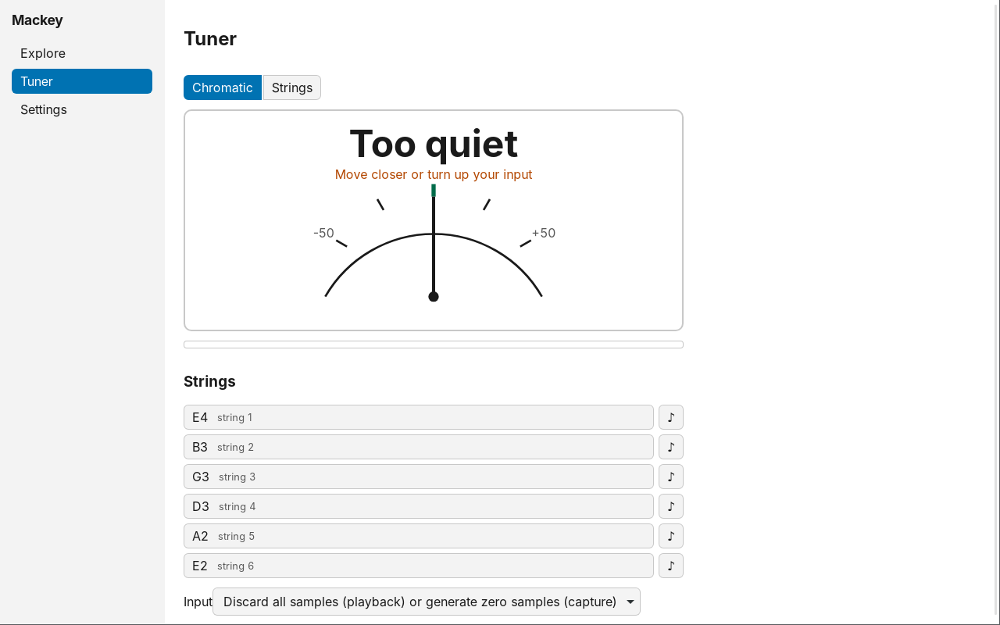

# Tuner

The tuner listens to one string at a time and tells you how far it is from the nearest note. Open it from the sidebar or with `Cmd-T`.

*The real tuner on a computer with no microphone: the app listens to silence and reports "Too quiet". With a guitar, the big letter is the note and the needle shows how many cents you are flat or sharp.*

## Microphone

The first time you open the Tuner it explains that the microphone is used only to hear your guitar and that nothing is recorded or sent anywhere. Choose **Continue**; macOS then asks for permission. The microphone is only open while the Tuner is on screen, and the analysis runs on your device.

If you decline, the tuner shows "Microphone access is off" with a button that opens System Settings. The reference tones still work. See [troubleshooting](troubleshooting.md#the-tuner-says-microphone-access-is-off).

If no microphone is found, the tuner says "No microphone found". Connect a microphone or audio interface. The **Input** menu at the bottom of the screen picks the device; it defaults to the system's default input.

## Reading the tuner

- **The note** (for example `A2`) is the nearest note to what you played.
- **Cents** say how far off you are: a negative number is flat, a positive one sharp. 100 cents is a semitone, and the needle's scale runs from -50 to +50. In tune is within a few cents of zero, and the needle turns green.
- **Messages.** "Too quiet" means the signal is below the threshold: move closer or raise the input level. "No stable pitch" means the app could not settle on one note, often because several strings are ringing; mute the others and pluck one string.

The tuner finds pitches between about 60 Hz and 1,400 Hz, which covers a guitar in any of the tunings the app offers.

## Modes

- **Chromatic** names any note you play.
- **Strings** lists the six strings of your current tuning, high string first (E4 to E2 in standard tuning). It picks the string closest to what you play, shows how far off it is, and ticks the string once it is in tune. The note button (♪) beside a string plays a reference tone, so you can tune by ear.

The strings follow the tuning you chose in [Explore](explorer.md#tunings-and-capo).

## Reference pitch

The tuner assumes A4 = 440 Hz. Change it between 415 and 466 Hz in [Settings](settings.md#tuner).

## What the mocked screenshots show

The developer docs also contain screenshots of the tuner with simulated readings (a flat A, an in-tune A), taken from the UI without a microphone: [flat](../docs/images/mock-tuner-flat-desktop.png) and [in tune](../docs/images/mock-tuner-in-tune-desktop.png). They show the layout of the readings, not real measurements.

Back to [user-docs](README.md).
